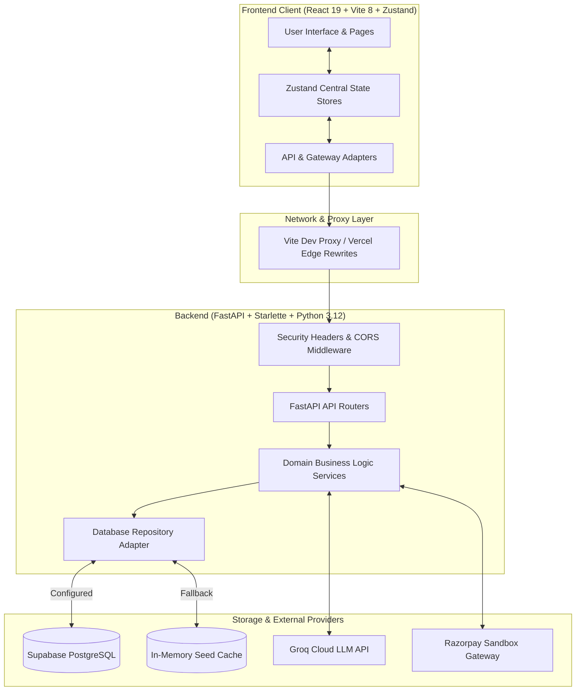
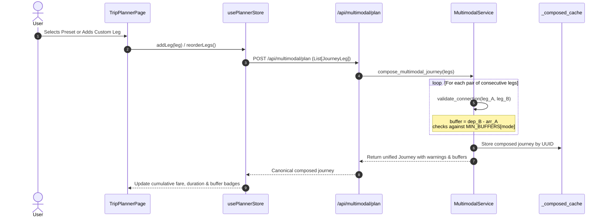
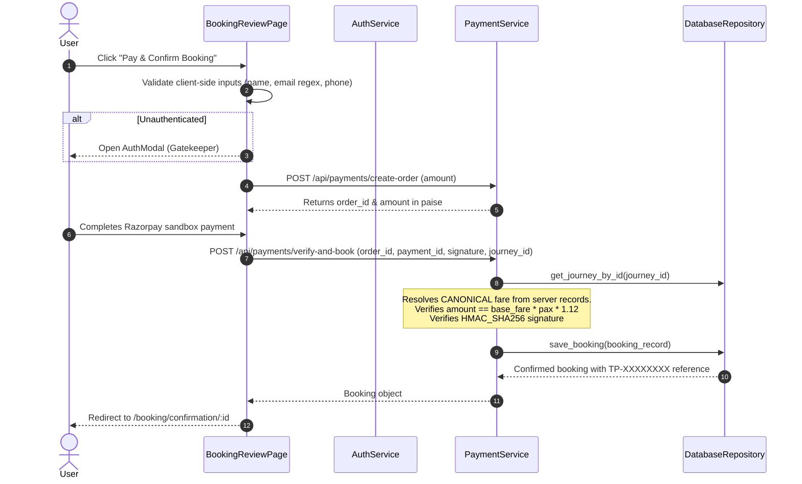

# TripPilot AI — System Architecture & Technical Specification

> **Document Type:** Technical Architecture Specification  
> **Status:** Current State Baseline (v1.0.0)  
> **Target System:** TripPilot AI  

---

## 1. High-Level Architecture Overview

TripPilot AI is structured as a modern decoupled client-server architecture consisting of an asynchronous single-page application (SPA) and a high-performance RESTful micro-framework backend.



---

## 2. Component & Module Architecture

### 2.1 Frontend Component Hierarchy
```
src/
├── app/
│   └── router.tsx                   # Central route table (Home, Explore, Planner, Review, Confirmation, Bookings)
├── components/
│   ├── layout/
│   │   ├── Header.tsx               # Nav, search switch, auth profile dropdown, AI drawer trigger
│   │   ├── Footer.tsx               # Prototype notices and branding
│   │   └── DemoDisclaimerBanner.tsx # Prominent disclaimer establishing simulated data
│   ├── auth/
│   │   └── AuthModal.tsx            # Login and registration modal with client-side password criteria
│   ├── search/
│   │   ├── UnifiedSearchWidget.tsx  # Origin/Destination inputs, date selector, passenger count
│   │   ├── ModeSelector.tsx         # 6 interactive transport mode pill buttons
│   │   └── QuickPromptChips.tsx     # Conversational prompt shortcuts
│   ├── filters/
│   │   ├── FilterSidebar.tsx        # Dynamic mode-specific filters (budget, airlines, train class, bus AC)
│   │   └── FilterChipBar.tsx        # Active filter tags with instant one-click removal
│   ├── journey-cards/
│   │   ├── JourneyCard.tsx          # Card listing with amenities, seat status, and booking CTA
│   │   ├── JourneyTimeline.tsx      # Vertical connecting timeline showing transit legs
│   │   └── CompareDrawer.tsx        # Fixed bottom comparison bar for up to 3 itineraries
│   ├── trip-planner/
│   │   ├── LegCard.tsx              # Draggable/reorderable leg card with mode switch
│   │   ├── TransferBufferCard.tsx   # Connection buffer health indicator (Comfortable vs Tight)
│   │   ├── LegEditModal.tsx         # Modal to configure individual leg details
│   │   └── MultimodalPresets.tsx    # 1-click corridor presets (e.g. Metro + Train + Cab)
│   └── ai-assistant/
│       ├── AIAssistantDrawer.tsx    # Global slide-over conversational drawer (Ctrl+K)
│       └── AIMessageBubble.tsx      # Renders chat messages and structured action cards
├── store/
│   ├── useSearchStore.ts            # Search parameters, filters, and active results
│   ├── usePlannerStore.ts           # Multimodal builder legs and itinerary composer state
│   ├── useBookingStore.ts           # Active draft journey, booking list, and checkout
│   ├── useAuthStore.ts              # Authenticated user, session JWT token, and auth modal state
│   ├── useAiStore.ts                # AI drawer visibility, message history, and action execution
│   └── useComparisonStore.ts        # Selected comparison items
└── services/
    ├── apiClient.ts                 # Strongly-typed HTTP wrapper communicating with backend
    └── razorpay.ts                  # Dynamic script loader and test credential helpers
```

### 2.2 Backend Domain & Service Hierarchy
```
backend/
├── app/
│   ├── config.py                    # Environment settings with secure secret generation
│   ├── main.py                      # FastAPI factory, security headers, CORS, validation handler
│   ├── supabase_client.py           # DatabaseRepository adapter with dual Supabase/in-memory engine
│   ├── models/
│   │   └── schemas.py               # Pydantic v2 data models with boundary validators
│   ├── routers/
│   │   ├── auth.py                  # Account registration, login, rate limiting, and current user
│   │   ├── metadata.py              # Transit hubs, cities, and coordinates
│   │   ├── journeys.py              # Search engine with parameter constraints and single journey lookup
│   │   ├── multimodal.py            # Multimodal itinerary composer and validator
│   │   ├── bookings.py              # Booking lifecycle with ownership verification (IDOR protection)
│   │   ├── payments.py              # Razorpay order generation and HMAC signature verification
│   │   └── ai.py                    # Natural language parser, Groq integration, and quick prompts
│   ├── services/
│   │   ├── auth_service.py          # Password hashing (PBKDF2) and stateless JWT generation
│   │   ├── journey_service.py       # City normalization, multi-criteria filtering, and sorting
│   │   ├── multimodal_service.py    # Transfer buffer calculations, leg chaining, and cache
│   │   ├── booking_service.py       # Cryptographic PNR generation (TP-XXXXXXXX) and persistence
│   │   ├── payment_service.py       # Razorpay order creation and HMAC-SHA256 signature verification
│   │   └── ai_service.py            # LLM prompt orchestration, action proposals, and fallback parser
│   └── data/
│       └── mock_db.py               # High-fidelity prototype dataset (20+ hubs, 200+ journeys across 6 modes)
├── requirements.txt                 # Backend Python dependencies
├── schema.sql                       # Idempotent PostgreSQL schema and RLS policies
└── seed_supabase.py                 # Automated cloud database populator
```

---

## 3. End-to-End Data Flow Models

### 3.1 Multimodal Connection & Buffer Calculation Flow


### 3.2 Secure Booking & Payment Flow


---

## 4. Security Architecture & Threat Model

| Threat Category | Potential Attack Vector | Implemented Architectural Defense |
| :--- | :--- | :--- |
| **Tampering** | Client manipulates journey fare to ₹1.00 in checkout payload | **Canonical Server Lookup:** The server strictly looks up `journey_id` in verified database records and calculates fare as `unit_fare * pax * 1.12`. Client-supplied prices are completely ignored. |
| **Access Control (IDOR)** | Attacker guesses booking reference to scrape passenger data or cancel trips | **Object-Level Authorization:** `verify_booking_ownership()` confirms that `booking.user_id == current_user.id` or matches the verified account email. Unauthorized callers receive `403 Forbidden`. |
| **Injection** | Malicious path parameters injected into PostgREST filters | **Strict Route Validation:** All ID path parameters are validated using regex `^[a-zA-Z0-9_\-]{3,64}$`, blocking PostgREST delimiter manipulation. |
| **Credential Stuffing** | Automated brute-force attacks against login and registration | **Sliding-Window IP Rate Limiter:** Auth endpoints restrict callers to 10 attempts per 60 seconds per IP with `429 Too Many Requests` responses. |
| **Cross-Origin Hijacking** | Malicious origins invoking APIs with user credentials | **Scoped CORS Middleware:** Removed wildcards. Restricted strictly to configured domain and project owner's verified preview deployments (`hariprathap1804`). |
| **Token Forgery** | Attacker creates forged JWTs using default keys | **Dynamic Key Generation:** In production, missing `SECRET_KEY` raises a fatal configuration exception. In development, a 256-bit ephemeral key is generated. |

---

## 5. Deployment Topology

```
┌───────────────────────────────────────────────────────────┐
│                    Production Deployment                  │
│                                                           │
│  ┌──────────────────────────────┐                         │
│  │     Vercel Frontend Edge     │                         │
│  │   https://trippilot.vercel   │                         │
│  └──────────────┬───────────────┘                         │
│                 │                                         │
│                 │ Cross-Origin HTTPS                      │
│                 │ (Authorization: Bearer <JWT>)           │
│                 ▼                                         │
│  ┌──────────────────────────────┐                         │
│  │  Railway / Render Container  │                         │
│  │      FastAPI Python 3.12     │                         │
│  └──────────────┬───────────────┘                         │
│                 │                                         │
│                 │ Secure PostgREST API                    │
│                 ▼                                         │
│  ┌──────────────────────────────┐                         │
│  │     Supabase PostgreSQL      │                         │
│  │   hubs, journeys, bookings   │                         │
│  └──────────────────────────────┘                         │
└───────────────────────────────────────────────────────────┘
```
