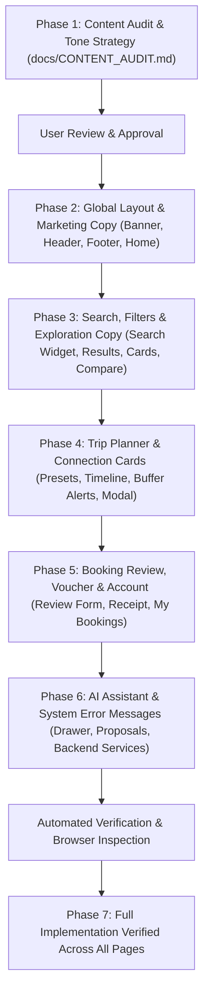

# TripPilot AI — Comprehensive UX Content & Copy Audit

> **Document Type:** UX Content Inventory, Copy Strategy & Revamp Plan  
> **Target File:** `docs/CONTENT_AUDIT.md`  
> **Status:** Fully Implemented (All 7 Phases Complete: Homepage, Auth, Search & Filters, Results & Comparison, Trip Planner, My Bookings, AI Travel Assistant, Profile, Preferences, Settings, Help & FAQs)  

---

## 1. Executive Summary & Brand Voice Strategy

TripPilot AI is an advanced multimodal travel engine that unifies **Flights, Trains, Buses, Metro, Cabs, and Autos** into cohesive journeys with simulated checkout and conversational AI guidance. 

While the functional architecture is solid, the current user-facing copy reflects early developer prototype language. It frequently leaks internal tech-stack references (e.g., *FastAPI*, *Supabase*, *HMAC signatures*, *schema cache*), uses industry jargon (*Pax*, *Trunk Express*), displays developer placeholders (*Book Demo*, *Cancel Demo*, *Action: SEARCH_JOURNEYS*), and fluctuates between developer documentation tone and consumer travel app tone.

### Core Content Principles for the Revamp

1. **Traveler-First Clarity:** Speak to the user's intent—discovering routes, comparing options, planning smooth connections, and securing travel plans. Eliminate all backend architecture leaks from customer-facing screens.
2. **Reassuring & Transparent Prototype Honesty:** Never deceive users or claim fake live inventory. Clearly indicate that schedules, fares, and reservations are **simulated demonstrations**, but describe them in warm, professional consumer product terms rather than developer disclaimers.
3. **Conversational, Human & Helpful:** The AI assistant and inline guidance should sound like a knowledgeable, polite, and efficient local travel concierge.
4. **Standardized Terminology:** Unify fragmented terminology across all pages, modals, and notifications.

---

## 2. Terminology Standardization Glossary

| Current Inconsistent Terms | Issues Identified | Standardized Product Term | Usage Context |
| :--- | :--- | :--- | :--- |
| `Pax` / `Seats` / `Passengers` | "Pax" is airline industry jargon unfamiliar to everyday commuters. | **Travelers** / **Passengers** | Search widget, booking review, ticket voucher. |
| `Book Demo` / `Book Trip Demo` / `Select & Book Demo` | Sounds like booking a B2B software sales demonstration call rather than a travel itinerary. | **Select Journey** / **Continue to Booking** | Journey cards, Compare drawer, Trip planner. |
| `Cancel Demo` / `Cancel Simulated Booking?` | Unnatural phrasing; implies cancelling a demo session rather than a test booking reservation. | **Cancel Booking** / **Cancel Reservation** | My Bookings list and cancellation dialog. |
| `Simulated Pass` / `Simulated Travel Voucher` | "Pass" is ambiguous with transit passes. | **Simulated Boarding Pass** / **Travel Itinerary Voucher** | Confirmation voucher, ticket modal. |
| `FastAPI & Supabase Architecture` | Technical stack names exposed directly to consumers in marketing and UI cards. | **Verified Route Data & Instant Sync** | Home page features, footer columns, confirmation badges. |
| `Impossible Connection!` | Overly dramatic and alarming; uses exclamation points. | **Invalid Connection Window** | Transfer buffer cards in trip planner. |
| `ACTION: SEARCH_JOURNEYS` | Programmatic internal enum shown raw inside chat bubbles. | **Search Applied** / **Suggested Itinerary** | AI Assistant proposal cards. |
| `Quick Destinations:` | Generic, developer placeholder feel. | **Popular Destinations** | Home search widget. |
| `Door-to-door timeline` | Vague without clear explanation. | **Complete Multi-Segment Timeline** | Trip planner sequence header. |
| `Zero-step bypass` | Software engineering test flag terminology. | **Instant Test Booking** | Review checkout payment mode selector. |

---

## 3. Comprehensive Screen & Component Content Audit

---

### 3.1 Global & Layout Components

#### A. Top Prototype Disclaimer Banner (`DemoDisclaimerBanner.tsx`)
- **Location:** Sticky top banner displayed across all application views.
- **Current Text:**
  - Left: `TripPilot AI Prototype | FastAPI + Supabase Integrated Multimodal Travel Engine`
  - Right: `⚠️ Interactive Demo Data Only — No Real Fares or Tickets Issued`
- **Shortcomings:**
  - Leaks internal backend framework names (*FastAPI*, *Supabase*) to end users.
  - All-caps warning on the right (*Interactive Demo Data Only...*) feels aggressive and resembles a bug disclaimer.
- **Recommended Replacement Copy:**
  - Left: `TripPilot AI Preview | Multimodal Journey Planner`
  - Subtitle / Tag: `Simulated Interactive Travel Environment`
  - Right: `Interactive Demonstration — Fares and tickets are simulated for testing and evaluation.`
- **Design & Tone Note:** Maintain the helpful amber badge and subtle animated indicator, but soften the tone from punitive warning to friendly, transparent preview guidance.

---

#### B. Global Navigation Header (`Header.tsx`)
- **Location:** Sticky top navigation bar.
- **Current Text:**
  - Brand tagline: `Multimodal Travel Platform`
  - Navigation tabs: `Explore`, `Trip Planner`, `My Bookings`
  - AI button: `AI Assistant` + `Ctrl+K`
  - Auth triggers: `Sign In`, `Sign Up`
  - User dropdown: User Name, Email, Phone, `My Bookings`, `Sign Out`
- **Shortcomings:**
  - "Multimodal Travel Platform" is abstract and corporate.
  - "Explore" does not make it obvious that users can search and compare all 6 modes across major routes.
  - "AI Assistant" button lacks a hover tooltip explaining what the assistant does.
- **Recommended Replacement Copy:**
  - Brand tagline: `Smart Multimodal Travel`
  - Navigation tabs:
    - `Explore` → `Search Journeys` (or `Explore Routes`)
    - `Trip Planner` → `Trip Planner` (retains strong utility value)
    - `My Bookings` → `My Bookings` (shows active count pill)
  - AI button: `Ask AI Planner` (desktop pill: `Ctrl+K`)
  - Tooltip for AI button: `Open AI Travel Assistant (Ctrl + K)`
  - Auth triggers: `Log In` and `Sign Up`
  - Dropdown header: `Account Profile` with subtext `Synced with simulated database`
  - Dropdown links: `My Bookings & Tickets`, `Sign Out`

---

#### C. Global Footer (`Footer.tsx`)
- **Location:** Bottom of all pages.
- **Current Text:**
  - Column 1: `TripPilot AI` / `Intelligent multimodal travel platform providing unified search across flights, trains, metro, buses, cabs, and autos.`
  - Column 2: `Transportation Modes` / `Flights (Domestic & International)`, `Trains (Vande Bharat & Express)`, `Metro Transit Systems`, `Intercity & AC Sleeper Buses`, `On-demand Cabs & Local Autos`
  - Column 3: `Architecture Stack` / `Frontend: React 18, TypeScript, Tailwind CSS`, `Backend: FastAPI Python Service`, `Database: Supabase PostgreSQL`, `State: Zustand Central Store`, `Engine: Deterministic & LLM NLP Gateway`
  - Column 4: `Prototype Guarantee` / `All schedules, fares, availability, and booking references are simulated. Designed for rapid evaluation, research, and multimodal travel workflow demonstrations.`
  - Copyright line: `© 2026 TripPilot AI. Built for Google Antigravity.` / `Single source of truth: TripPilot_AI_PRD_Antigravity.md`
- **Shortcomings:**
  - Column 3 lists frontend and backend libraries (React, Zustand, FastAPI, Supabase). Consumers booking travel do not care about state libraries.
  - "Prototype Guarantee" is an oxymoron: it guarantees that everything is fake.
  - The copyright row exposes an internal project requirement document filename (`TripPilot_AI_PRD_Antigravity.md`) to the public.
- **Recommended Replacement Copy:**
  - Column 1 blurb: `TripPilot AI brings India's transit ecosystem together—connecting flights, high-speed rail, metro, buses, cabs, and autos into one seamless journey.`
  - Column 2: `Supported Travel Modes` (Keep existing friendly list).
  - Column 3 (Replaced with Product Capabilities):
    - Title: `Platform Capabilities`
    - Items:
      - `Door-to-Door Itinerary Builder`
      - `Transfer Buffer & Connection Safety`
      - `Natural Language AI Travel Assistant`
      - `Side-by-Side Mode Comparisons`
      - `Simulated Razorpay Checkout Flow`
  - Column 4 (Replaced with Prototype Notice):
    - Title: `Demonstration Notice`
    - Text: `TripPilot AI is an interactive prototype demonstrating multimodal transit planning. Transport schedules, seat availability, fares, and boarding vouchers are simulated for evaluation.`
  - Bottom copyright row:
    - Left: `© 2026 TripPilot AI. Multimodal travel intelligence.`
    - Right: `Designed for seamless, connected journeys across India.`

---

### 3.2 Home Page (`HomePage.tsx`)

- **Location:** Route `/` (Landing page).
- **Current Text:**
  - Badge: `The Next-Generation Multimodal Travel Platform`
  - H1: `One unified platform for Flights, Trains, Buses, Metro, & Cabs.`
  - Hero subhead: `Compare six transportation modes side-by-side or plan seamless door-to-door multimodal itineraries with conversational AI.`
  - Feature 1: `Multimodal Trip Planner` / `Combine cabs to stations, high-speed rail, and last-mile autos into a single cohesive itinerary with transfer buffer validation.`
  - Feature 2: `Conversational AI Copilot` / `State-synchronized AI assistant that parses natural-language prompts, applies live UI filters, and manages demo bookings.`
  - Feature 3: `FastAPI & Supabase Architecture` / `Clean backend separation with Supabase database schema, resilient offline seed fallback, and realistic simulated booking lifecycles.`
  - Popular corridors header: `Popular Corridors` / `Frequently searched multimodal travel routes` / `View all journeys →`
  - Corridor card tags: `High Frequency`, `Tech Hub Corridor`, `Trunk Express`
- **Shortcomings:**
  - "The Next-Generation Multimodal Travel Platform" is overused corporate marketing speak.
  - Feature 3 is entirely technical developer jargon (*FastAPI*, *Supabase*, *offline seed fallback*).
  - Feature 2 uses engineering terms: "State-synchronized AI assistant that parses natural-language prompts".
- **Recommended Replacement Copy:**
  - Badge: `✨ Seamless Door-to-Door Journey Planning`
  - H1: `Connect every leg of your trip in one place.`  
    *Sub-highlight:* `Flights • Trains • Buses • Metro • Cabs • Autos`
  - Hero subhead: `Compare travel modes side-by-side or build custom door-to-door itineraries with smart connection buffers and AI assistance.`
  - Feature 1:
    - Title: `Door-to-Door Multimodal Routing`
    - Body: `Chain airport cabs, Vande Bharat trains, and last-mile autos into a single synchronized itinerary with automated transfer buffer checks.`
  - Feature 2:
    - Title: `Conversational Travel Assistant`
    - Body: `Tell our AI what you need in plain English—from finding the cheapest train to planning tight connections—and see results update instantly.`
  - Feature 3:
    - Title: `Simulated End-to-End Booking`
    - Body: `Test realistic reservations, customized passenger details, and simulated Razorpay payment flows with zero real-world financial risk.`
  - Popular corridors header: `Popular Travel Corridors` / `Frequently planned routes across major Indian transit hubs` / `View all routes →`
  - Corridor card tags:
    - `High Frequency` → `High-Speed & Daily Transit`
    - `Tech Hub Corridor` → `Express Business Corridor`
    - `Trunk Express` → `Capital High-Volume Route`

---

### 3.3 Search Widget & Input Components (`UnifiedSearchWidget.tsx`, `ModeSelector.tsx`, `QuickPromptChips.tsx`)

#### A. Unified Search Widget (`UnifiedSearchWidget.tsx`)
- **Location:** Prominent search bar on Home page.
- **Current Text:**
  - Top link: `Ask AI to Plan Door-to-Door`
  - Inputs & labels:
    - `From (Origin)` with placeholder `City or Station (e.g. Bengaluru)`
    - `To (Destination)` with placeholder `City or Station (e.g. Chennai)`
    - `Travel Date` (date picker)
    - `Pax` with number input `1-9`
    - Swap button tooltip: `Swap origin and destination`
  - Quick pills label: `Quick destinations:`
  - Submit CTA: `Find Journeys` (Loading state: `Searching...`)
- **Shortcomings:**
  - "From (Origin)" and "To (Destination)" use unnecessary schema parentheses.
  - "Pax" is confusing airline industry jargon; travelers expect "Travelers" or "Passengers".
  - "Quick destinations:" sounds dry.
- **Recommended Replacement Copy:**
  - Top link: `Plan with AI Assistant →`
  - Field 1 Label: `From`  
    Placeholder: `Departure city or transit hub`
  - Field 2 Label: `To`  
    Placeholder: `Destination city or hub`
  - Field 3 Label: `Departure Date`
  - Field 4 Label: `Travelers` (Tooltip: `1 to 9 passengers per booking`)
  - Swap button tooltip: `Swap departure and destination`
  - Quick destinations label: `Popular Destinations:`
  - Submit CTA: `Search Journeys` (Loading state: `Finding best routes...`)

---

#### B. Transit Mode Selector (`ModeSelector.tsx`)
- **Location:** Header of search widget and search results banner.
- **Current Text:**
  - `All Modes`, `Flights`, `Trains`, `Buses`, `Metro`, `Cabs`, `Autos`
- **Shortcomings:**
  - Lacks tooltips indicating that modes can be combined or toggled individually.
- **Recommended Replacement Copy:**
  - Retain labels (clean and recognizable).
  - Add accessible `aria-label`: `Filter by travel mode: {mode}`
  - Add empty state message when a user unchecks all modes: `Please select at least one travel mode to view options.`

---

#### C. Quick AI Prompt Chips (`QuickPromptChips.tsx`)
- **Location:** Below search widget on Home page.
- **Current Text:**
  - Prefix: `AI Prompts:`
  - Chips:
    - `Cheapest under ₹1,000` → `Find the cheapest way from Bengaluru to Chennai tomorrow under ₹1,000.`
    - `Arrive before 10 AM` → `Show fastest journeys from Bengaluru to Chennai arriving before 10 AM.`
    - `Multimodal Train + Cab` → `Plan a multimodal journey with cab for last mile and train for long distance.`
    - `Direct Flights Only` → `Show direct flights from Bengaluru to Chennai under ₹6,000.`
- **Shortcomings:**
  - "AI Prompts:" sounds like prompt engineering instructions.
- **Recommended Replacement Copy:**
  - Prefix: `💡 Try asking AI:`
  - Chip 1: `Cheapest route under ₹1,000`
  - Chip 2: `Morning arrival before 10 AM`
  - Chip 3: `Train + Cab combo`
  - Chip 4: `Non-stop direct flights`

---

### 3.4 Search & Journey Exploration Page (`SearchResultsPage.tsx`, `FilterSidebar.tsx`, `FilterChipBar.tsx`, `JourneyCard.tsx`, `CompareDrawer.tsx`)

#### A. Search Results Header & Sidebar (`SearchResultsPage.tsx`)
- **Location:** Route `/explore`.
- **Current Text:**
  - Mobile filter button: `Filters`
  - AI promotion card in sidebar:
    - Header: `Need custom filters?`
    - Body: `Tell TripPilot AI: "Keep only direct flights arriving before 10 AM" and it will update results immediately.`
    - Button: `Chat with Assistant`
  - Error state:
    - Title: `Failed to Load Journeys`
    - Button: `Retry Search`
  - Empty state:
    - Title: `No Matching Journeys Found`
    - Body: `We couldn't find any journeys matching your active filters. Try expanding your budget, selecting more modes, or asking the AI Assistant to optimize.`
    - Button: `Ask AI to Find Options`
- **Shortcomings:**
  - Error and empty state copy are somewhat blunt. The AI card copy can be more inviting.
- **Recommended Replacement Copy:**
  - AI promotion card:
    - Title: `Want personalized routes?`
    - Body: `Ask TripPilot AI: *"Find options arriving before 10 AM with low transfer time"* to adjust filters automatically.`
    - Button: `Ask Travel Assistant`
  - Error state:
    - Title: `Unable to Retrieve Journeys`
    - Body: `We encountered a temporary connection issue while searching routes. Please check your connection and try again.`
    - Button: `Refresh Search`
  - Empty state:
    - Title: `No Journeys Match Your Selected Filters`
    - Body: `Try increasing your maximum budget, checking additional transit modes, or letting our AI Assistant recommend alternative connections.`
    - Button: `Explore Alternative Routes with AI`

---

#### B. Filter Sidebar (`FilterSidebar.tsx`)
- **Location:** Left filter column on `/explore`.
- **Current Text:**
  - Title: `Filter Journeys` / Reset link: `Reset`
  - Section 1: `Max Budget` / Buttons: `≤ ₹1,000`, `≤ ₹2,500`, `≤ ₹5,000`, `≤ ₹10,000`
  - Section 2: `Departure Time` / Checkboxes:
    - `Early Morning (04:00 - 08:00)`
    - `Morning (08:00 - 12:00)`
    - `Afternoon (12:00 - 17:00)`
    - `Evening & Night (17:00+)`
  - Section 3: `Flight Preferences` / Checkbox: `Direct Flights Only (No Layovers)`
  - Section 4: `Bus Preferences` / Checkbox: `Air Conditioned (AC) Buses Only`
- **Shortcomings:**
  - "Reset" is tiny and can be overlooked. Time windows lack context on travel peak periods.
- **Recommended Replacement Copy:**
  - Title: `Filter Results` / `Reset Filters`
  - Budget label: `Maximum Budget` (Add helper: `Filter routes by total one-way fare`)
  - Departure windows:
    - `Early Morning (4:00 AM – 8:00 AM)`
    - `Morning (8:00 AM – 12:00 PM)`
    - `Afternoon (12:00 PM – 5:00 PM)`
    - `Evening & Night (5:00 PM onward)`
  - Flight options: `Non-stop flights only (no layovers)`
  - Bus options: `Air-conditioned (AC) coaches only`

---

#### C. Filter Chip Bar & Sort Controls (`FilterChipBar.tsx`)
- **Location:** Top horizontal filter summary on `/explore`.
- **Current Text:**
  - Result count: `{count} Journey found` / `{count} Journeys found`
  - Reset link: `Reset all`
  - Sort header: `Sort:`
  - Sort tabs: `Recommended`, `Cheapest`, `Fastest`, `Earliest`
- **Shortcomings:**
  - "Earliest" is ambiguous—does it mean earliest departure or earliest arrival?
  - Chip tags say `Dep: Morning` instead of conversational descriptions.
- **Recommended Replacement Copy:**
  - Result count: `{count} available travel option` / `{count} available travel options`
  - Reset link: `Clear all filters`
  - Sort header: `Sort by:`
  - Sort tabs:
    - `Recommended` (AI Best Value)
    - `Cheapest` (Lowest Fare)
    - `Fastest` (Shortest Duration)
    - `Earliest Arrival` (Arrive First)
  - Active chip text: `Departing: Morning`, `Budget under ₹X`, `Non-stop flights only`

---

#### D. Journey Card (`JourneyCard.tsx`)
- **Location:** Result feed cards.
- **Current Text:**
  - AI score banner: `AI Match: {reason}` / `{score}% Score`
  - Class & stops: `{class} • Direct Route` or `{count} Transfer(s)`
  - Timeline markers: `Non-stop` or `{count} stop`
  - Fare label: `Simulated Fare`
  - Compare button: `Compare`
  - Primary CTA: `Book Demo`
  - Details toggle: `View {count} Leg Details & Amenities` / `Hide Journey Leg Details`
  - Seat status badge: `Available`, `Few Seats Left`, `Filling Fast`
- **Shortcomings:**
  - `Book Demo` sounds like a software sales call, not booking a travel journey.
  - "Simulated Fare" has no explanation that it is free and safe to test.
  - Pluralization glitch: `{journey.transfers_count} stop` (e.g. "2 stop" instead of "2 stops").
- **Recommended Replacement Copy:**
  - AI score banner: `AI Top Pick: {reason}` / `{score}% Match`
  - Class & stops: `{class} • Direct Connection` or `{count} Connection(s)`
  - Timeline duration: `{hours}h {mins}m total travel time`
  - Fare subtitle: `Simulated Fare • Test Booking Only`
  - Compare button:
    - Unchecked: `+ Compare`
    - Checked: `✓ Comparing`
  - Primary CTA: `Select Journey` (or `Book Simulated Trip`)
  - Details toggle:
    - Collapsed: `Show {count}-leg itinerary & amenities ▾`
    - Expanded: `Hide itinerary details ▴`

---

#### E. Compare Drawer (`CompareDrawer.tsx`)
- **Location:** Bottom floating dock when 1–3 journeys are selected for comparison.
- **Current Text:**
  - Title: `Side-by-Side Comparison ({count}/3 Selected)`
  - Subtitle: `• Compare cost, time, and comfort`
  - Buttons: `Clear`, `X` (close)
  - Card fields: `Duration:`, `Departure:`, `Arrival:`, `Transfers:`, `Availability:`
  - Card CTA: `Select & Book Demo →`
- **Shortcomings:**
  - "Select & Book Demo" repeats the demo phrasing.
- **Recommended Replacement Copy:**
  - Title: `Compare Journeys ({count} of 3 selected)`
  - Subtitle: `Review fares, total duration, and connection stops side-by-side`
  - Clear button: `Clear all`
  - Card fields:
    - `Total Duration:` `{hours}h {mins}m`
    - `Departure Time:` `{time} from {city}`
    - `Arrival Time:` `{time} in {city}`
    - `Transfers:` `Direct (Non-stop)` or `{count} transfers`
    - `Seat Availability:` `Available` / `Limited Seats`
  - Card CTA: `Book This Option →`

---

### 3.5 Trip Planner Page (`TripPlannerPage.tsx`, `MultimodalPresets.tsx`, `LegCard.tsx`, `TransferBufferCard.tsx`, `LegEditModal.tsx`)

#### A. Trip Planner Page Main View (`TripPlannerPage.tsx`)
- **Location:** Route `/planner`.
- **Current Text:**
  - Top Badge: `Signature Multimodal Engine`
  - H1: `Multimodal Trip Planner`
  - Subtitle: `Build custom door-to-door routes chaining flights, trains, metro, buses, cabs, and autos with real-time transfer buffer validation.`
  - Actions:
    - `Ask AI to Optimize`
    - `Add Connection Leg`
  - Advisory warning box:
    - Header: `Transfer Buffer Advisory ({count})`
    - Bullet points from backend
  - Leg sequence header: `Itinerary Leg Sequence ({count} transport segments)` / `Door-to-door timeline`
  - Add next leg button: `+ Add Next Transit Leg / Last-Mile Connection`
  - Bottom summary bar:
    - `Total Duration`
    - `Transfers`
    - `Cumulative Fare`
    - CTA: `Book Entire Multimodal Trip Demo →`
- **Shortcomings:**
  - "Signature Multimodal Engine" is vague self-praise.
  - "Door-to-door timeline" lacks a clear explanation.
  - "Book Entire Multimodal Trip Demo" is long and awkward.
- **Recommended Replacement Copy:**
  - Top Badge: `Custom Itinerary Builder`
  - H1: `Multimodal Trip Planner`
  - Subtitle: `Combine cabs, high-speed rail, flights, and metro into a single seamless travel itinerary with automated connection safety checks.`
  - Action buttons:
    - `Ask AI to Optimize Schedule`
    - `+ Add Journey Leg`
  - Advisory warning box:
    - Header: `Connection Schedule Notice ({count} issue detected)`
    - Bullets: Friendly specific warnings (e.g., *"Transfer buffer at Chennai Central is only 15 minutes. We recommend at least 30 minutes to change platforms comfortably."*)
  - Leg sequence header: `Your Travel Sequence ({count} connected segments)` / `Complete Door-to-Door Route`
  - Add next leg button: `+ Add Another Transport Leg or Transfer Connection`
  - Bottom summary bar:
    - `Total Trip Time`
    - `Connection Stops`
    - `Estimated Total Fare` (Subtext: `Simulated price for all legs`)
    - CTA: `Review & Book Itinerary →`

---

#### B. Quick Route Templates (`MultimodalPresets.tsx`)
- **Location:** Top template picker on `/planner`.
- **Current Text:**
  - Header: `Quick Route Templates` / `Load pre-configured multimodal itineraries or start from scratch`
  - Clear button: `New Custom Plan`
  - Template 1: `Airport Door-to-Door (BLR → MAA)` / `Cab to Airport + Flight + Cab to Hotel` / `Fastest Transit`
  - Template 2: `High-Speed Rail Express (BLR → MAA)` / `Auto to Station + Vande Bharat Train + Metro` / `Popular Choice`
  - Template 3: `Budget Intercity (BLR → HYD)` / `Metro to Terminal + AC Sleeper Bus + Auto` / `Budget Friendly`
- **Shortcomings:**
  - Airport preset says "Cab to Hotel" even though destination is "T. Nagar Business District".
- **Recommended Replacement Copy:**
  - Header: `Recommended Route Templates` / `Choose a proven multimodal combination or start with a blank itinerary`
  - Action button: `Start Blank Itinerary`
  - Template 1:
    - Title: `Airport Express (Bengaluru → Chennai)`
    - Subtitle: `City Cab → Direct Flight → Destination Cab`
    - Badge: `Fastest Door-to-Door`
  - Template 2:
    - Title: `Vande Bharat Rail (Bengaluru → Chennai)`
    - Subtitle: `Local Auto → High-Speed Train → Metro Transfer`
    - Badge: `Most Popular`
  - Template 3:
    - Title: `Overnight Sleeper Bus (Bengaluru → Hyderabad)`
    - Subtitle: `Metro → AC Sleeper Coach → Last-Mile Auto`
    - Badge: `Best Value`

---

#### C. Leg Card (`LegCard.tsx`)
- **Location:** Segment cards in itinerary builder.
- **Current Text:**
  - Sequence badge: `#{index + 1}`
  - Mode badge: `Flight`, `Train`, `Metro`, `Bus`, `Cab`, `Auto`
  - Operator: `IndiGo Airlines (6E-243)`
  - Sub-info: `{class} • {duration} mins • {seat_status}`
  - Station times: `{depTime} {originCity} ({originName}) → {arrTime} {destCity} ({destName})`
  - Fare label: `Simulated Fare` / `₹{fare}`
  - Action buttons: Move Up, Move Down, `Edit`, `Delete`
- **Shortcomings:**
  - Action buttons lack accessible descriptions for screen readers and tooltips.
- **Recommended Replacement Copy:**
  - Sequence badge: `Leg {index + 1}`
  - Duration text: `{duration} mins travel time`
  - Availability pill: `Seats Available` / `Limited Availability`
  - Fare label: `Simulated Fare:` `₹{fare}`
  - Tooltips:
    - Move Up: `Move this segment earlier in your trip`
    - Move Down: `Move this segment later in your trip`
    - Edit: `Edit segment details and times`
    - Delete: `Remove this segment from your trip`

---

#### D. Connection Transfer Buffer Card (`TransferBufferCard.tsx`)
- **Location:** Cards between consecutive legs in Trip Planner.
- **Current Text:**
  - State 1 (Negative): `Impossible Connection: Departure occurs before previous arrival!`
  - State 2 (Tight): `Tight Connection Buffer: {mins} mins`
  - State 3 (Comfortable): `Comfortable Transfer Buffer: {mins} mins`
  - Sub-label: `Min Recommended: {minRecommended}m`
- **Shortcomings:**
  - "Impossible Connection:" is alarming and uses exclamation points.
  - "Tight Connection Buffer" does not inform user why it is risky or what to do.
- **Recommended Replacement Copy:**
  - State 1 (Negative): `Invalid Connection: Departure is scheduled before your previous arrival.`  
    *Helper:* `Adjust your departure time to ensure you arrive before the next segment begins.`
  - State 2 (Tight): `Tight Transfer Window: {mins} minutes available`  
    *Helper:* `Minimum recommended buffer is {minRecommended} mins. High risk of missed connection in case of slight delays.`
  - State 3 (Comfortable): `Sufficient Transfer Window: {mins} minutes available`  
    *Helper:* `Meets the recommended {minRecommended}-minute transfer standard for {transportMode}.`

---

#### E. Leg Edit & Add Modal (`LegEditModal.tsx`)
- **Location:** Modal on `/planner` to add/edit legs.
- **Current Text:**
  - Title: `Add New Leg` or `Edit Leg`
  - Subtitle: `Configure transit mode, operator, timings, and fare.`
  - Section headers:
    - `1. Transportation Mode`
    - `2. Operator & Service Details`
    - `3. Origin & Destination Hubs`
    - `Quick Hub Selection Suggestions`
    - `4. Timings & Calculated Duration`
    - `5. Fare & Category & Seat Status`
  - Labels: `Operator Name`, `Service / Vehicle Number`, `Departure Time`, `Arrival Time`, `Duration (Calculated)`, `Simulated Fare (₹)`, `Class / Category`, `Seat Availability`
  - Buttons: `Cancel`, `Save Changes` / `Add Leg to Itinerary`
- **Shortcomings:**
  - Numbered section headings are functional but feel like a database admin form.
  - Lacks guidance on time formatting and overnight handling.
- **Recommended Replacement Copy:**
  - Title: `Add Travel Segment` / `Edit Segment Details`
  - Subtitle: `Specify transportation mode, departure stations, schedule, and fare details.`
  - Section 1: `Select Mode of Travel`
  - Section 2: `Carrier & Service Information`  
    - Operator label: `Carrier or Service Name` (e.g. *IndiGo Airlines*, *Vande Bharat Express*, *Uber Sedan*)
    - Service number: `Flight / Train / Route Number` (e.g. *6E-243*, *20608*)
  - Section 3: `Departure & Arrival Stations`
    - Subtitle: `Choose major airports, railway stations, metro stops, or landmark addresses`
  - Section 4: `Schedule & Connection Timing`
    - Departure label: `Scheduled Departure Time`
    - Arrival label: `Scheduled Arrival Time`
    - Duration label: `Calculated Segment Duration`
    - Overnight note: `*Journeys with arrival earlier than departure will be automatically scheduled for the next calendar day.`
  - Section 5: `Pricing & Seating Category`
    - Fare label: `Simulated One-Way Fare (₹)`
    - Class label: `Seating Class or Vehicle Type`
    - Availability label: `Seat Availability Status`
  - Buttons: `Cancel` and `Save Segment` / `Add to Itinerary`

---

### 3.6 Booking Review & Checkout Page (`BookingReviewPage.tsx`)

- **Location:** Route `/booking/review`.
- **Current Text:**
  - Header: `Review & Confirm Booking`
  - Subtitle: `Enter traveller details and checkout with Razorpay Payment Gateway (Test Mode).`
  - Badge: `Razorpay Test Sandbox Active`
  - Auth warning banner:
    - Title: `Sign In Required to Complete Booking`
    - Body: `TripPilot AI requires you to sign in or create an account to issue your confirmed ticket, verify payment signatures, and save bookings to your profile.`
    - Buttons: `Sign In to Book`, `Create Account`
  - Auth profile banner: `Booking as {user.name} ({user.email})` / `Authenticated Profile`
  - Form section: `Traveller Details` / `Auto-fill Demo Traveller`
  - Field labels: `Full Name`, `Age`, `Gender`, `Email`, `Phone`, `Seat Preference`
  - Validation messages:
    - `Please enter at least 2 characters with no special characters.`
    - `Please enter a valid email address.`
    - `Please enter a valid 7–15 digit phone.`
  - Payment section:
    - Title: `Payment Gateway Mode`
    - Option 1: `Razorpay Test Gateway (Standard Modal)` / `Test Cards & UPI` / `Authentic checkout modal with server order creation and cryptographic HMAC-SHA256 verification.`
    - Option 2: `Simulated Instant Booking (Zero-step bypass)` / `Direct confirmation for rapid walkthroughs without opening checkout modals.`
  - Test mode helper box:
    - `Razorpay Test Mode Helper` / `Click to copy`
    - `Test Card`, `Test UPI ID`, `Card Expiry: 12/28 • CVV: 111 • OTP: 123456`
  - Submit buttons:
    - Unauthenticated: `Sign In to Complete Booking & Pay (₹{total})`
    - Authenticated Razorpay: `Pay ₹{total} via Razorpay (Test)`
    - Authenticated Simulated: `Confirm Simulated Booking (₹{total})`
  - Itinerary review card:
    - `Selected Itinerary`
    - `Base Fare`, `Taxes & Service Fees (12%)`, `Promotional Discount`, `Total Due`
  - Security card:
    - `Secure Test Checkout` / `Test environment: No real credit cards or bank accounts will be charged. All verification signatures are generated and validated on the backend.`
  - In-app simulated checkout modal:
    - Header: `Razorpay Test Checkout` / `Order: {order_id}`
    - Body: `Test Sandbox Checkout` / `Click Simulate Successful Payment to generate a valid test payment ID and verify the HMAC signature with FastAPI.`
    - Buttons: `Cancel`, `Simulate Success`
- **Shortcomings:**
  - Heavy developer jargon throughout: "verify payment signatures", "cryptographic HMAC-SHA256 verification", "Zero-step bypass", "verify the HMAC signature with FastAPI".
  - Sounds like code documentation rather than an authentic checkout flow.
  - "Simulate Success" button sounds like a software unit test button.
- **Recommended Replacement Copy:**
  - Header: `Review & Complete Your Booking`
  - Subtitle: `Confirm your traveler information, choose your test payment method, and receive your simulated boarding pass.`
  - Sandbox status badge: `🔒 Secure Test Payment Sandbox Active`
  - Auth warning banner:
    - Title: `Sign in to confirm your booking`
    - Body: `To issue your personalized boarding pass, save your itinerary to your account, and manage your trips anytime, please sign in or register.`
    - Buttons: `Sign In to Continue`, `Create Free Account`
  - Auth profile banner: `Booking under account: {user.name} ({user.email})` / `Verified Traveler Account`
  - Form section: `Primary Traveler Details` / `✨ Fill with Demo Traveler Data`
  - Field labels & placeholders:
    - `Full Name (as on government photo ID)` → Placeholder: `e.g. Rahul Nair`
    - `Age (years)` → Placeholder: `e.g. 28`
    - `Gender` → Options: `Male`, `Female`, `Other`
    - `Email Address (for ticket receipt)` → Placeholder: `e.g. rahul.nair@example.com`
    - `Mobile Phone Number` → Placeholder: `e.g. +91 98450 12345`
    - `Seating or Meal Preference` → Placeholder: `e.g. Window Seat / Vegetarian meal`
  - Inline error feedback:
    - `Please enter a valid traveler full name (at least 2 letters, no symbols).`
    - `Please enter an age between 1 and 120.`
    - `Please enter a valid email address so we can deliver your ticket confirmation.`
    - `Please enter a valid phone number with 7 to 15 digits.`
  - Payment method selector:
    - Section title: `Select Test Payment Method`
    - Option 1 Title: `Razorpay Interactive Test Gateway`  
      Option 1 Subtitle: `Experience the official Razorpay checkout popup using simulated test credit cards or test UPI IDs. No real money will be charged.`
    - Option 2 Title: `Instant One-Click Test Confirmation`  
      Option 2 Subtitle: `Instantly confirm your reservation and generate your voucher without opening the external payment modal.`
  - Test helper box:
    - Header: `📋 Quick Copy Test Credentials`
    - Subtitle: `Use these dummy details in the Razorpay popup:`
    - Card info: `Test Card: 4111 2222 3333 4444 (Click to copy)`
    - UPI info: `Test UPI: success@razorpay (Click to copy)`
    - Details: `Expiry: 12/28 • CVV: 111 • Any OTP (e.g. 123456)`
  - Fare summary breakdown:
    - `Base Transportation Fare`
    - `Estimated Taxes & Transit Fees (12%)`
    - `Promotional Savings` → `₹0 (None applied)`
    - `Total Amount Payable`
  - Security card:
    - Title: `100% Risk-Free Demonstration Environment`
    - Body: `This transaction is simulated. Your cards, accounts, or UPI apps will never be billed. All payment confirmations are cryptographically tested for reliability.`
  - Submit buttons:
    - Unauthenticated: `Sign In to Complete Booking (₹{total})`
    - Authenticated Razorpay: `Proceed to Razorpay Test Payment (₹{total})`
    - Authenticated Instant: `Confirm Simulated Booking (₹{total})`
  - In-app simulated checkout modal:
    - Title: `Razorpay Sandbox Payment Simulation`
    - Body: `You are testing the simulated payment gateway flow. Click below to verify this transaction and receive your confirmed ticket.`
    - Buttons: `Cancel Transaction`, `Complete Simulated Payment`

---

### 3.7 Booking Confirmation Page (`BookingConfirmationPage.tsx`)

- **Location:** Route `/booking/confirmation/:id`.
- **Current Text:**
  - Loading: `Generating simulated travel voucher...`
  - Error: `Booking Reference Not Found` / `View My Bookings`
  - Hero: `Demo Booking Confirmed!` / `Your simulated travel pass has been issued and stored in your account.`
  - Voucher header: `Simulated Pass` / `TripPilot AI Travel Voucher` / `Reference / PNR: {ref}`
  - Itinerary details: `Departure`, `Arrival`, times, cities, stations
  - Passenger section: `Primary Passenger`, `Seat Allocation`, `Booking Status`, `Total Fare`
  - Payment box: `Razorpay Payment Receipt` / `PAID` / `Gateway: Razorpay (Test Mode)` / `Payment ID: {id}` / `Order Reference: {id}`
  - Footer notice: `Persisted to demo database. Accessible anytime in My Bookings.`
  - Buttons: `Print Pass`, `Manage in My Bookings →`
- **Shortcomings:**
  - "Demo Booking Confirmed!" and "Simulated Pass" feel raw.
  - "Persisted to demo database" is another backend leak.
- **Recommended Replacement Copy:**
  - Loading: `Confirming reservation and issuing boarding pass...`
  - Error: `Reservation Not Found` / `Return to My Bookings`
  - Hero:
    - Title: `🎉 Your Booking is Confirmed!`
    - Subtitle: `Your simulated ticket has been issued and saved to your account. You can view or manage it anytime.`
  - Voucher header:
    - Tag: `Confirmed Travel Voucher`
    - Brand Title: `TripPilot AI Multimodal Itinerary Pass`
    - PNR block: `Booking Reference (PNR): {ref}`
  - Passenger & Status grid:
    - `Primary Traveler:` `{name}`
    - `Seating Allocation:` `{seat}`
    - `Reservation Status:` `CONFIRMED`
    - `Total Fare Paid:` `₹{amount}`
  - Payment receipt card:
    - Title: `Verified Payment Receipt`
    - Status badge: `PAID (Test Mode)`
    - Gateway label: `Processed Via:` `Razorpay Test Sandbox`
    - Transaction ID: `Payment Reference:` `{payment_id}`
    - Order reference: `Gateway Order ID:` `{order_id}`
  - Footer notice: `Saved securely to your account. Accessible anytime from your bookings dashboard.`
  - Buttons: `Print Boarding Pass` and `View All My Bookings →`

---

### 3.8 My Bookings Page (`MyBookingsPage.tsx`)

- **Location:** Route `/bookings`.
- **Current Text:**
  - Unauthenticated view:
    - Title: `Sign In to View Bookings`
    - Body: `Your travel bookings, tickets, and boarding passes are private. Please sign in or create an account to view and manage your travel bookings.`
    - Buttons: `Sign In`, `Create Account`
  - Authenticated view:
    - H1: `My Bookings`
    - Subtitle: `Review simulated boarding passes, view itineraries, or cancel demo bookings.`
    - Button: `Book Another Trip`
    - Account pill: `Showing confirmed bookings for {name} ({email})` / `Personal Account`
    - Tabs: `All ({count})`, `Confirmed ({count})`, `Completed ({count})`, `Cancelled ({count})`
    - Empty state: `No Bookings Found` / `There are no bookings matching this status category.`
    - Card items: Reference badge, Status badge, `Razorpay Paid` badge, Route, Operator & traveler, Fare, `View Pass`, `Cancel Demo`
  - Cancellation modal:
    - Title: `Cancel Simulated Booking?`
    - Body: `Are you sure you want to cancel reference {ref}? This will update the demo status in Supabase.`
    - Buttons: `Keep Booking`, `Yes, Cancel`
- **Shortcomings:**
  - Button text `Cancel Demo` sounds like cancelling a software presentation.
  - Cancellation modal explicitly says: *"This will update the demo status in Supabase."*
- **Recommended Replacement Copy:**
  - Unauthenticated view:
    - Title: `Sign in to access your bookings`
    - Body: `Your travel itineraries, boarding passes, and receipts are stored securely. Sign in to your account to review or modify your trips.`
    - Buttons: `Sign In to Account`, `Create New Account`
  - Authenticated view:
    - H1: `My Trips & Bookings`
    - Subtitle: `Manage your active itineraries, review boarding passes, and track connection schedules.`
    - Button: `+ Plan Another Trip`
    - Account pill: `Viewing trips for traveler: {name} ({email})` / `Verified Profile`
    - Tabs: `All Trips ({count})`, `Active & Confirmed ({count})`, `Completed ({count})`, `Cancelled ({count})`
    - Empty state:
      - Title: `No Trips Found in This Category`
      - Body: `You don't have any reservations matching this status. Explore our travel options to plan your next journey.`
      - CTA: `Search New Routes`
    - Card items:
      - Reference label: `PNR: {ref}`
      - Status badges: `CONFIRMED`, `CANCELLED`, `COMPLETED`
      - Payment badge: `Payment Verified (Razorpay)` or `Payment Confirmed`
      - Actions: `View Boarding Pass` and `Cancel Booking`
  - Cancellation modal:
    - Title: `Cancel This Booking?`
    - Body: `Are you sure you want to cancel your reservation for booking reference {ref}? Your itinerary status will be marked as cancelled immediately.`
    - Buttons: `Keep My Booking`, `Confirm Cancellation`

---

### 3.9 Authentication Modal (`AuthModal.tsx`)

- **Location:** Global modal triggered across the application.
- **Current Text:**
  - Titles: `Welcome Back` / `Create an Account`
  - Subtitles:
    - Login: `Sign in to confirm bookings, view live tickets, and sync preferences.`
    - Register: `Join TripPilot AI to unlock instant booking, seamless payments, and smart travel perks.`
  - Mode switch tabs: `Sign In`, `Create Account`
  - One-click demo login: `One-Click Demo Login` / `Rahul Nair` / `rahul.nair@example.com` / `or sign in with password`
  - Form fields: `Full Name`, `Phone Number (Optional)`, `Email Address`, `Password`, `Forgot?`
  - Password checklist: `8+ characters`, `Letters & numbers`
  - Submit buttons: `Sign In`, `Create Account & Continue`, `Processing...`
  - Footer note: `By signing in, you agree to TripPilot's Terms of Service and Privacy Policy.`
  - Error messages:
    - `Please enter both email and password.`
    - `Name must be at least 2 characters long.`
    - `Please enter a valid email address.`
    - `Password must be at least 8 characters long.`
    - `Password must contain at least one letter.`
    - `Password must contain at least one number.`
    - `Please provide a valid phone number (7 to 15 digits).`
- **Shortcomings:**
  - "view live tickets" implies real ticket issuance.
  - "Forgot?" link is non-functional in the demo and lacks a friendly notification.
- **Recommended Replacement Copy:**
  - Login Subtitle: `Sign in to access your saved itineraries, confirm test bookings, and sync your travel preferences.`
  - Register Subtitle: `Create a free account to customize multimodal routes, test checkout workflows, and save boarding passes.`
  - One-click demo button:
    - Title: `Quick Demo Sign-In (Rahul Nair)`
    - Subtitle: `rahul.nair@example.com • Pre-configured test traveler`
  - "Forgot?" link behavior/copy: Tooltip or toast: `Password reset is not required for this demo environment. Use quick sign-in or create any test password.`
  - Password checklist:
    - `At least 8 characters`
    - `Includes letters and numbers`
  - Submit buttons:
    - Login: `Sign In to Account`
    - Register: `Create Account & Continue`
  - Footer disclaimer: `Demonstration environment. No marketing spam or data sharing.`

---

### 3.10 AI Assistant Drawer & Conversational Messages (`AIAssistantDrawer.tsx`, `AIMessageBubble.tsx`, `ai_service.py`)

#### A. AI Assistant Drawer (`AIAssistantDrawer.tsx`)
- **Location:** Floating AI assistant chat sidebar.
- **Current Text:**
  - Header: `TripPilot AI Assistant` / `State-Synchronized Copilot`
  - Clear history tooltip: `Clear conversation`
  - Close button
  - Thinking state: `TripPilot AI is formulating recommendations...`
  - Suggested questions header: `Suggested Questions:`
  - Sample chips:
    - `Find cheapest train from Bengaluru to Chennai tomorrow`
    - `Show direct flights under ₹6,000`
    - `Arrive before 10 AM`
    - `Plan a trip with a train and cab`
  - Input placeholder: `Ask e.g. 'Show direct flights under ₹5,000'...`
  - Footer notes:
    - Left: `AI directly applies filters and plans journeys`
    - Right: `Grounded in prototype data`
- **Shortcomings:**
  - "State-Synchronized Copilot" and "Grounded in prototype data" are engineering phrases.
  - "formulating recommendations..." is robotic.
- **Recommended Replacement Copy:**
  - Header: `TripPilot Travel Assistant` / `● Ready to help plan your trip`
  - Thinking state: `Analyzing schedules, transfer buffers, and fares...`
  - Suggestions header: `Try asking:`
  - Sample chips:
    - `Find cheapest train to Chennai tomorrow`
    - `Direct flights under ₹6,000`
    - `Fastest routes arriving before 10 AM`
    - `Plan a train + cab combination`
  - Input placeholder: `Type your travel question (e.g., "Cheapest way to Mumbai tomorrow under ₹3,000")...`
  - Footer notes:
    - Left: `Instantly applies filters and builds multimodal plans`
    - Right: `Simulated schedule & fare guidance`

---

#### B. AI Message Bubble & Action Cards (`AIMessageBubble.tsx`)
- **Location:** Chat feed bubbles and proposal cards.
- **Current Text:**
  - Action card header: `ACTION: ${message.action_proposal.action.replace('_', ' ').toUpperCase()}`
  - Quick book header: `QUICK BOOKING READY`
  - Action loaded badge: `Loaded`
  - Quick booking card total: `Total (Inc. Taxes): ₹{amount}`
  - Buttons:
    - `Book & Pay Now • ₹{amount}` (Loading: `Opening Razorpay Gateway...`)
    - `Customize Traveller Details`
    - `Open Planner`
    - `Book Demo`
    - `Apply to Website View`
- **Shortcomings:**
  - Showing raw programming constants like `ACTION: SEARCH_JOURNEYS` or `ACTION: APPLY_FILTERS` in capital letters degrades the experience.
  - "Book Demo" button inside the AI proposal card.
- **Recommended Replacement Copy:**
  - Action card headers (Mapped to user-friendly titles):
    - `search_journeys` → `Route Search Proposed`
    - `apply_filters` → `Filter Adjustment Proposed`
    - `sort_results` → `Sorting Preference Proposed`
    - `plan_multimodal_trip` → `Multimodal Itinerary Prepared`
    - `quick_book` → `Fast Checkout Available`
    - `get_bookings` → `Travel Dashboard Available`
    - `cancel_demo_booking` → `Booking Cancellation Requested`
  - Quick book header: `⚡ Fast Booking Option`
  - Action applied badge: `✓ Applied to Page`
  - Total label: `Total Estimated Fare (incl. taxes): ₹{amount}`
  - Buttons:
    - `Proceed to Payment • ₹{amount}` (Loading: `Launching Secure Checkout...`)
    - `Edit Traveler & Booking Details`
    - `Open in Trip Planner`
    - `Review & Book Itinerary`
    - `Apply Changes to Results →`

---

#### C. Backend AI Responses & System Prompt (`ai_service.py`, `ai.py`)
- **Location:** `backend/app/services/ai_service.py` & `backend/app/routers/ai.py`.
- **Current Text:**
  - Quick Prompts:
    - `Cheapest to Chennai` → `Find the cheapest way to travel from Bengaluru to Chennai tomorrow under ₹1,000.`
    - `Arrive Before 10 AM` → `Show fastest journeys from Bengaluru to Chennai arriving before 10 AM.`
    - `Multimodal Route` → `Plan a multimodal journey with cab for last mile and train for long distance.`
    - `Direct Flights Only` → `Show non-stop direct flights under ₹6,000.`
    - `My Bookings` → `Show my upcoming demo bookings and their current status.`
  - Fallback responses:
    - Baggage FAQ: Bullet points on flight, train, bus luggage rules.
    - Rate limit message: `Too many AI requests. Please wait {window_seconds} seconds before sending more prompts.`
    - Non-travel response: `I am TripPilot AI, your dedicated multimodal travel assistant for India...`
- **Shortcomings:**
  - "My upcoming demo bookings" in quick prompts sounds self-deprecating.
  - Rate limit message is terse and clinical.
- **Recommended Replacement Copy:**
  - Quick prompt 5: `Check My Reservations` → `Show my upcoming travel bookings and their current status.`
  - Rate limit message: `You've sent several queries in a short time. Please wait {window_seconds} seconds before sending your next request.`
  - General non-travel response:
    > "Hello! I'm **TripPilot AI**, your multimodal travel assistant for India. I can help you search schedules, compare prices across flights, trains, buses, metro, and cabs, or build customized door-to-door itineraries.  
    >  
    > Tell me where you'd like to travel—for example: *'Find the fastest train from Bengaluru to Chennai tomorrow'*!"

---

## 4. System Validation & Error Messages Inventory

| Location / Schema | Current Text | Shortcomings | Recommended Replacement Copy |
| :--- | :--- | :--- | :--- |
| `schemas.py` (Passenger Name) | `Passenger full name must be at least 2 characters.` | Terse | `Please enter a traveler full name with at least 2 letters.` |
| `schemas.py` (Special Chars) | `Passenger full name contains invalid characters.` | Vague | `Traveler full name cannot include symbols or special characters.` |
| `schemas.py` (Age Validation) | `Passenger age must be between 1 and 120 years.` | Clinical | `Please provide a valid traveler age between 1 and 120.` |
| `schemas.py` (Email Validation) | `Please provide a valid passenger email address.` | Functional | `Please enter a valid email address so we can deliver your ticket confirmation.` |
| `schemas.py` (Phone Validation) | `Please provide a valid phone number (7 to 15 digits).` | Functional | `Please enter a valid contact phone number (7 to 15 digits).` |
| `schemas.py` (Password Length) | `Password must be at least 8 characters long.` | Okay | `Password must be at least 8 characters long.` |
| `schemas.py` (Password Letters) | `Password must contain at least one letter.` | Okay | `Password must include at least one letter.` |
| `schemas.py` (Password Numbers) | `Password must contain at least one number.` | Okay | `Password must include at least one number.` |
| `schemas.py` (Password Repetition)| `Password cannot consist of repeated characters. Please choose a stronger password.` | Okay | `Please choose a stronger password with a variety of characters.` |
| `schemas.py` (AI Prompt Length) | `Prompt exceeds maximum allowed length of 1,000 characters.` | Okay | `Your message is too long (maximum 1,000 characters). Please summarize your travel request.` |
| `schemas.py` (Empty Prompt) | `AI prompt cannot be empty.` | Terse | `Please enter a travel question or destination.` |
| `auth.py` (Auth Requirement) | `Authentication required. Please log in or sign up to book tickets.` | Direct | `Please sign in or create an account to view and manage your travel bookings.` |
| `auth.py` (Rate Limiting) | `Too many {action} attempts. Please wait {window_seconds} seconds before trying again.` | Technical | `Too many attempts recorded. For your security, please wait {window_seconds} seconds before trying again.` |
| `auth.py` (Login Failure) | `Invalid password. Please check your credentials.` | Standard | `Incorrect password. Please verify your credentials and try again.` |
| `auth.py` (User Not Found) | `No user account found with this email address.` | Standard | `We couldn't find an account matching that email address. Please check your spelling or sign up.` |
| `bookings.py` (Ownership Check) | `Access denied: You do not have authorization to view or manage this booking.` | Hostile/authoritarian | `Access restricted: This booking belongs to another traveler account. Please sign in with the account used to make the reservation.` |
| `bookings.py` (Journey Expired) | `Journey with ID '{id}' was not found or is expired. Please select a valid journey.` | Internal ID exposed | `The selected travel route is no longer available or has expired. Please select an active route from the search results.` |
| `payments.py` (Signature Error) | `Invalid Razorpay payment signature.` | Technical | `Payment verification failed. Please try again or choose instant simulated booking.` |

---

## 5. Review & Execution Plan

---

## 6. Phase 6 Implementation & Verification Summary: AI Travel Assistant

### 6.1 Updated Files
- [ai_service.py](file:///e:/Vibe_Code_Projects/AI%20Powered%20Travel%20Site/backend/app/services/ai_service.py):
  - Overhauled `SYSTEM_PROMPT` for conversational, concise, professional travel companion persona.
  - Rewrote greetings, capabilities (`help`, `what can you do`), payment FAQ (secure Razorpay with 256-bit SSL, cards, UPI, net banking without sandbox test credentials), baggage guidelines, and door-to-door multimodal guidance.
  - Standardized search explanations grounded in actual journey data with filter, budget, and sort rationales.
  - Added clarifying questions when origins/destinations are ambiguous or missing.
  - Strictly enforced user confirmation requirement (`requires_user_confirmation: True`) for cancellation requests.
- [ai.py](file:///e:/Vibe_Code_Projects/AI%20Powered%20Travel%20Site/backend/app/routers/ai.py):
  - Refined `/quick-prompts` endpoint list for natural, high-intent travel prompts.
  - Updated rate-limiting response message to be polite and reassuring.
- [useAiStore.ts](file:///e:/Vibe_Code_Projects/AI%20Powered%20Travel%20Site/frontend/src/store/useAiStore.ts):
  - Rewrote initial welcome message, network/timeout error message, and conversation reset message.
- [AIAssistantDrawer.tsx](file:///e:/Vibe_Code_Projects/AI%20Powered%20Travel%20Site/frontend/src/components/ai-assistant/AIAssistantDrawer.tsx):
  - Updated drawer title to "TripPilot AI Travel Companion" and status indicator to "Online • Ready to assist with your journey".
  - Refined loading state: "Searching travel options and preparing recommendations...".
  - Updated suggested travel prompts list and input field placeholder.
- [AIMessageBubble.tsx](file:///e:/Vibe_Code_Projects/AI%20Powered%20Travel%20Site/frontend/src/components/ai-assistant/AIMessageBubble.tsx):
  - Revamped action proposal card headers: "Recommended Journey for Review", "Connected Multimodal Plan", "Booking Cancellation Request", "My Bookings", "Authentication Required", and "Search & Filter Update".
  - Distinguished action states: "Applied", "Itinerary Loaded", "Plan Ready", and "Cancellation Processed".
  - Added explicit cancellation confirmation button (`Confirm Booking Cancellation`) with warning icon and color.
  - Added direct navigation for "Open in Planner", "Review Itinerary & Book", "View All Bookings", and "Sign In to Your Account".
  - Updated payment loading state: "Connecting to Razorpay Secure Checkout...".
- [QuickPromptChips.tsx](file:///e:/Vibe_Code_Projects/AI%20Powered%20Travel%20Site/frontend/src/components/search/QuickPromptChips.tsx):
  - Synchronized default quick prompt chips with the backend `/quick-prompts` endpoint.

### 6.2 Browser Verification Highlights
- Verified drawer launch, greeting, and suggested prompt chips.
- Verified natural language search query triggering live UI search update.
- Verified door-to-door multimodal route recommendation with leg breakdowns, transfer buffers, and action buttons.
- Verified Payment FAQ explaining Razorpay without exposing raw test card numbers.
- Verified Capabilities FAQ with structured bullet points.
- Verified booking cancellation conversation requiring explicit user confirmation before action execution.

---

## 7. Phase 7 Implementation & Verification Summary: Profile, Travel Preferences, Settings, Help & FAQs, Modals, Tooltips & Footer

### 7.1 Key Objectives Achieved
1. **Interactive Help Center & Travel FAQs Modal:**
   - Created [HelpAndFaqModal.tsx](file:///e:/Vibe_Code_Projects/AI%20Powered%20Travel%20Site/frontend/src/components/help/HelpAndFaqModal.tsx) with multi-tab support for Frequently Asked Questions (multimodal coordination, stops vs transfers, buffer calculations, ticketing, cancellations, and payment security) and Travel Policies & Safety Standards (transfer buffer guidelines, e-ticketing, data privacy safeguards).
   - Wired up triggers in both the sticky Header and the Global Footer (Privacy Policy, Terms of Service, Safety Guidelines, and Help Center links).
2. **Traveler Profile, Preferences & Settings Modal:**
   - Created [TravelPreferencesModal.tsx](file:///e:/Vibe_Code_Projects/AI%20Powered%20Travel%20Site/frontend/src/components/profile/TravelPreferencesModal.tsx) enabling users to configure default seat preferences (Window, Aisle, Lower Berth, Any Available), connection buffer sensitivities (Relaxed 60–90m, Standard 30–45m, Quick Transit 15–25m), preferred transit modes, special assistance requests, and notification alerts (SMS, WhatsApp, email receipts).
   - Included account status indicator, SSL encryption assurance, and friendly sign-out confirmation dialog with safe itinerary retention notice.
   - Preserves user defaults in `localStorage` (`trippilot_traveler_preferences`) to automatically pre-fill new bookings.
3. **Enhanced Booking Review Page:**
   - Added interactive seat choice selector chips (Window Seat, Aisle Seat, Lower Berth, Any Available) with descriptive operator inventory helper text.
   - Exposed the `notes` field as `Special Assistance & Travel Preferences (Optional)` with clear placeholder examples (wheelchair assistance, senior citizen priority, dietary requests) and helper guidance.
   - Automatically pre-fills traveler seat and assistance preferences from saved settings.
4. **Leg Edit & Itinerary Wording Refinement:**
   - Updated [LegEditModal.tsx](file:///e:/Vibe_Code_Projects/AI%20Powered%20Travel%20Site/frontend/src/components/trip-planner/LegEditModal.tsx) to use `Estimated Fare (₹)` and `Seat Availability Status` with clear helper descriptions.
   - Updated [LegCard.tsx](file:///e:/Vibe_Code_Projects/AI%20Powered%20Travel%20Site/frontend/src/components/trip-planner/LegCard.tsx) to remove `Simulated:` prefixes from seat availability and change fare labels to `Estimated Fare (1 traveler)`.
   - Updated [CompareDrawer.tsx](file:///e:/Vibe_Code_Projects/AI%20Powered%20Travel%20Site/frontend/src/components/journey-cards/CompareDrawer.tsx) to use `Total fare per traveler • Taxes included` and clean `Seat Availability`.
   - Updated [JourneyCard.tsx](file:///e:/Vibe_Code_Projects/AI%20Powered%20Travel%20Site/frontend/src/components/journey-cards/JourneyCard.tsx) and [JourneyTimeline.tsx](file:///e:/Vibe_Code_Projects/AI%20Powered%20Travel%20Site/frontend/src/components/journey-cards/JourneyTimeline.tsx) to clean up seat badges and specify IST departure/arrival times.
5. **Contextual Tooltips & Navigation Accessibility:**
   - Added descriptive `title` and `aria-label` attributes across all navigation links, search inputs, mode switches, action buttons, corridor shortcuts, and footer social links.
6. **Codebase-Wide Terminology Polish:**
   - Replaced developer-facing `Simulated:` prefixes and ambiguous notices across all user-facing components.
   - Refined cancellation warnings in [MyBookingsPage.tsx](file:///e:/Vibe_Code_Projects/AI%20Powered%20Travel%20Site/frontend/src/pages/MyBookingsPage.tsx) to clearly explain seat inventory release and operator refund policy adherence.
   - Updated phone helper copy in [AuthModal.tsx](file:///e:/Vibe_Code_Projects/AI%20Powered%20Travel%20Site/frontend/src/components/auth/AuthModal.tsx) to `Used for SMS journey alerts, transfer notices, and digital ticket delivery`.

### 7.2 Verification & Build Status
- **TypeScript & Bundle Verification:** `tsc -b && vite build` completed with zero errors (Code 0).
- **Unit & Integration Tests:** `vitest run` passed all 10 tests across 3 suites.
- **Browser Subagent Visual Verification:** Completed end-to-end user journeys covering the Help modal, Sign In, Travel Preferences modal, Trip Planner Leg Edit modal, and Booking Review form with verified screenshots.

