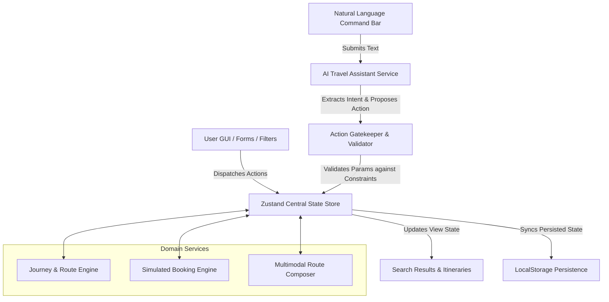
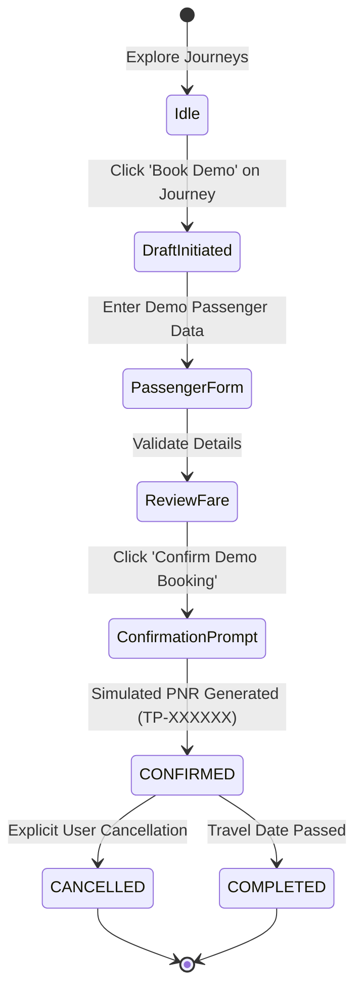
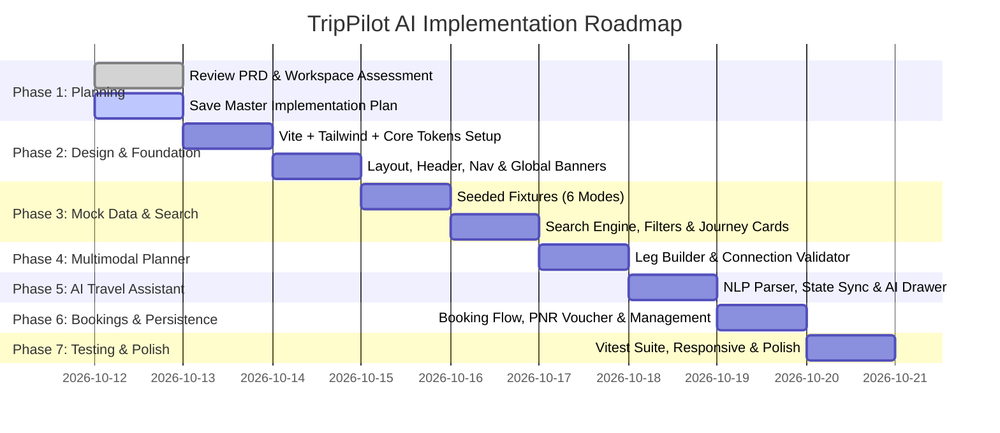

# TripPilot AI — Master Implementation Plan

**Document Version:** 1.0.0  
**Status:** Under Review / Awaiting User Approval  
**Source of Truth:** [`TripPilot_AI_PRD_Antigravity.md`](file:///e:/Vibe_Code_Projects/AI%20Powered%20Travel%20Site/TripPilot_AI_PRD_Antigravity.md)  
**Target Environment:** Node.js v23.4.0, npm 10.9.0, Windows, Google Antigravity  

---

## 1. Repository and Environment Assessment

### 1.1 Existing Workspace State
- **Current Files:** Only [`TripPilot_AI_PRD_Antigravity.md`](file:///e:/Vibe_Code_Projects/AI%20Powered%20Travel%20Site/TripPilot_AI_PRD_Antigravity.md) is present in the workspace root.
- **Project Structure:** Clean greenfield workspace. No legacy code, package dependencies, or conflicting configurations exist.
- **Git Status:** Git is available (`v2.46.0`). Workspace is not yet initialized as a git repository.
- **Runtime Environment:** Modern Node.js (`v23.4.0`) and npm (`10.9.0`) on Windows PowerShell.

### 1.2 Technology Selection & Rationale
In accordance with PRD Section 9 and Web Application Development guidelines:
- **Core Framework:** **React 18 + TypeScript + Vite**. Provides instant HMR, high development velocity, strict type safety, and zero backend compilation overhead for the prototype.
- **Styling & Design System:** **Tailwind CSS + Custom CSS Design Tokens**. Fast component authoring, clean utility classes, consistent spacing, and custom CSS variables for bespoke luxury travel aesthetics (ivory background, deep indigo `#1E1B4B`, cobalt blue `#2563EB`, violet AI gradients).
- **Icons:** **Lucide React**. Comprehensive travel icons (plane, train, bus, car, compass, map-pin, sparkler, filter, check-circle, etc.).
- **Animation & Transitions:** **Framer Motion**. Fluid card entry, accordion transitions, filter chip badges, modal drawer slides, and glowing AI assistant states.
- **State Management:** **Zustand**. Lightweight, decoupled store architecture allowing direct updates between the AI assistant and UI controls with zero boilerplate or unnecessary re-renders.
- **Persistence:** **Browser LocalStorage** with strongly-typed schemas, default seed fallback, and state synchronization across sessions.
- **Testing:** **Vitest** for unit/integration testing of filtering algorithms, multimodal validations, booking state machine, and AI action parsing.

---

## 2. Architecture and Technology Decisions

### 2.1 Unified State Architecture
The fundamental architectural principle mandated by Section 15 of the PRD is that **the AI Assistant and the conventional GUI must operate on the exact same shared application state and the exact same domain services**.



### 2.2 Layered System Design
```
┌────────────────────────────────────────────────────────┐
│                    Presentation Layer                  │
│  - Landing & Command Bar    - Search Results & Filters │
│  - Journey Cards & Compare  - Multimodal Trip Planner  │
│  - Demo Booking Flow        - AI Persistent Drawer     │
└───────────────────────────┬────────────────────────────┘
                            │
┌───────────────────────────▼────────────────────────────┐
│                    State & Context Layer               │
│  - useSearchStore           - useComparisonStore       │
│  - usePlannerStore          - useBookingStore          │
│  - useAiStore               - useUserPreferencesStore  │
└───────────────────────────┬────────────────────────────┘
                            │
┌───────────────────────────▼────────────────────────────┐
│                    Domain Services                     │
│  - JourneyService (Search, Filter, Sort, Mode Logic)   │
│  - MultimodalService (Leg validation, Connections)     │
│  - BookingService (Lifecycle, PNR generator, Storage)  │
│  - AIService (NLP parser, Action mapper, Gatekeeper)   │
└───────────────────────────┬────────────────────────────┘
                            │
┌───────────────────────────▼────────────────────────────┐
│                    Data & Storage                      │
│  - Seeded Fixtures (Flights, Trains, Metro, Bus, etc.) │
│  - LocalStorage Engine (Bookings, Preferences, Drafts) │
└────────────────────────────────────────────────────────┘
```

---

## 3. Page and Navigation Map

### 3.1 Route Hierarchy
| Route | Page Component | Purpose | Key Parameters / State |
|---|---|---|---|
| `/` | `HomePage` | Hero section, unified search widget, AI prompt shortcuts, popular routes, value proposition | Query syncs to search store |
| `/explore` | `SearchResultsPage` | Full search results across modes, mode tabs, dynamic sidebar filters, sorting options, compare dock | `?origin=&destination=&date=&mode=&class=` |
| `/journey/:id` | `JourneyDetailsPage` | Comprehensive leg-by-leg timeline, amenities, baggage, fare breakdown, simulated availability | Route param `:id` |
| `/planner` | `TripPlannerPage` | Multimodal itinerary builder, leg reordering, alternative modes, connection validation | Active draft itinerary |
| `/booking/review` | `BookingReviewPage` | Demo passenger details form, fare review, mock disclaimer, simulated payment bypass | Selected journey in draft state |
| `/booking/confirmation/:id` | `BookingConfirmationPage`| Generated simulated PNR/ticket pass, printable summary, itinerary overview | Route param `:id` |
| `/bookings` | `MyBookingsPage` | List of upcoming, completed, and cancelled demo bookings; status badges; cancel/modify dialog | LocalStorage backed |
| `/profile` | `ProfilePage` | Demo traveller personas, travel preferences (budget priority, seat choice, accessibility) | User preference store |

### 3.2 Persistent Overlays & Global Controls
- **Global Header:** Brand logo, primary navigation links, active bookings count badge, AI Assistant toggle button, quick-action search bar.
- **Persistent AI Assistant:** Accessible from anywhere via floating trigger button or global hotkey (`Cmd/Ctrl + K`); opens as a slide-over drawer or split-screen companion.
- **Compare Drawer:** Bottom docked bar that slides up when 1 to 3 journeys are flagged for comparison.
- **Simulated Demo Watermark/Banner:** Unobtrusive top banner reminding users: *"TripPilot AI is an interactive prototype. All fares, schedules, and bookings are simulated."*

---

## 4. Component Hierarchy and Design System

### 4.1 Design Tokens & Aesthetic Direction
In compliance with the PRD and Visual Design guidelines:
- **Background:** Luxury Ivory / Alabaster (`#FBFBFD` / `bg-slate-50`). Clean, premium, high contrast without harsh white glare.
- **Primary Accents:** Deep Indigo (`#1E1B4B` / `indigo-950`) and Crisp Cobalt (`#2563EB` / `blue-600`).
- **AI Accents:** Subtle Violet / Electric Indigo gradients (`linear-gradient(135deg, #6366F1 0%, #A855F7 100%)`).
- **Surface Elevation:** Subtle glassmorphic cards (`bg-white/80 backdrop-blur-md border border-slate-200/60 shadow-sm hover:shadow-md transition-all`).
- **Typography:** Modern clean sans-serif (Inter / Outfit) with clear hierarchical sizing and tabular numbers for fares and times.
- **Micro-interactions:** Smooth spring animations for filter badge dismissal, pulse highlights when AI modifies filters, tab transitions with sliding underlines.

### 4.2 Component Architecture
```
src/
├── components/
│   ├── layout/
│   │   ├── Header.tsx                 # Main nav, search quick-switch, AI trigger
│   │   ├── Footer.tsx                 # Prototype notices, links, demo resetting
│   │   ├── DemoDisclaimerBanner.tsx   # Top banner establishing simulated state
│   │   └── Container.tsx              # Standard responsive wrapper
│   ├── search/
│   │   ├── UnifiedSearchWidget.tsx    # Origin, destination, dates, mode selector
│   │   ├── LocationCombobox.tsx       # Auto-suggest for 20+ supported cities/stations
│   │   ├── ModeSelector.tsx           # 6 transportation icons with active states
│   │   ├── PassengerCounter.tsx       # Adults, children, travel class selector
│   │   └── DatePickerPopover.tsx      # Single/return date selector with presets
│   ├── filters/
│   │   ├── FilterSidebar.tsx          # Dynamic container rendering active mode filters
│   │   ├── FilterChipBar.tsx          # Active filter badges with instant 'x' remove
│   │   ├── PriceRangeSlider.tsx       # Dual-thumb budget slider
│   │   ├── TimeWindowFilter.tsx       # Early morning, morning, afternoon, evening
│   │   ├── ModeSpecificFilters/       # Sub-filters per mode:
│   │   │   ├── FlightFilters.tsx      # Airlines, stops, cabin, baggage
│   │   │   ├── TrainFilters.tsx       # Train class (1A, 2A, 3A, SL), quota, amenities
│   │   │   ├── MetroFilters.tsx       # Line color, interchange limit, walking buffer
│   │   │   ├── BusFilters.tsx         # Sleeper/seater, AC, operator
│   │   │   ├── CabFilters.tsx         # Sedan, SUV, EV, capacity
│   │   │   └── AutoFilters.tsx        # Standard, EV, distance
│   ├── journey-cards/
│   │   ├── JourneyCard.tsx            # Main card for journey listing
│   │   ├── JourneyTimeline.tsx        # Visual connecting line between stops/legs
│   │   ├── AmenityBadgeList.tsx       # Wifi, food, power plug, luggage indicators
│   │   ├── AIRecommendationBadge.tsx  # "Why AI recommends this" explanation tooltip
│   │   └── CompareCheckbox.tsx        # Add/remove from 3-journey comparison dock
│   ├── trip-planner/
│   │   ├── MultimodalLegList.tsx      # Drag-and-drop or step list of legs
│   │   ├── LegCard.tsx                # Single leg (e.g. Cab to Station)
│   │   ├── TransferBufferWarning.tsx  # Highlights tight transfers (< 15-30m)
│   │   ├── AddLegModal.tsx            # Add custom intermediate leg
│   │   └── MultimodalSummaryBar.tsx   # Cumulative fare, duration, carbon estimate
│   ├── bookings/
│   │   ├── PassengerDetailsForm.tsx   # Quick mock traveller form with "Fill Demo Data"
│   │   ├── FareBreakdownCard.tsx      # Base fare, simulated taxes, service fees
│   │   ├── BookingVoucher.tsx         # Boarding pass / ticket representation
│   │   ├── BookingCard.tsx            # Card in My Bookings list
│   │   └── CancelBookingDialog.tsx    # Explicit confirmation modal for cancellations
│   └── ai-assistant/
│       ├── AIAssistantDrawer.tsx      # Floating / docked AI conversation panel
│       ├── AIMessageBubble.tsx        # Assistant and user chat messages
│       ├── AIActionCard.tsx           # Rendered structured card (e.g., "Filtered 12 trains")
│       ├── QuickPromptChips.tsx       # "Cheapest under ₹1,500", "Arrive before 9 AM"
│       └── AIExecutionIndicator.tsx   # Animated processing state with action preview
```

---

## 5. Domain Models and TypeScript Interfaces

All domain models will be placed in `src/types/`:

### 5.1 Transport & Journey Types (`src/types/journey.ts`)
```typescript
export type TransportMode = 'flight' | 'train' | 'metro' | 'bus' | 'auto' | 'cab';

export interface LocationHub {
  id: string;
  name: string;
  city: string;
  code?: string; // e.g. BLR, MAS, SBC, NDLS
  type: 'airport' | 'railway_station' | 'metro_station' | 'bus_terminal' | 'landmark' | 'address';
  coordinates: { lat: number; lng: number };
}

export interface Amenity {
  id: string;
  label: string;
  iconName: string;
}

export interface JourneyLeg {
  id: string;
  mode: TransportMode;
  operator: string;
  serviceNumber?: string; // Flight 6E-204, Train 12626, Bus KA-01-F-1234
  origin: LocationHub;
  destination: LocationHub;
  departureTime: string; // ISO 8601 string
  arrivalTime: string;   // ISO 8601 string
  durationMinutes: number;
  fare: number;
  classOrCategory: string; // Economy, 3A, Seater AC, UberGo, etc.
  stopsCount: number;
  stopDetails?: string[];
  amenities: Amenity[];
  baggageAllowance?: string;
  seatAvailabilityStatus: 'Available' | 'Filling Fast' | 'Few Seats Left' | 'RAC / Waitlist';
  seatAvailabilityCount?: number;
}

export interface Journey {
  id: string;
  isMultimodal: boolean;
  modes: TransportMode[];
  origin: LocationHub;
  destination: LocationHub;
  departureTime: string;
  arrivalTime: string;
  totalDurationMinutes: number;
  totalFare: number;
  legs: JourneyLeg[];
  transfersCount: number;
  transferBufferMinutes: number;
  recommendedScore: number; // 0-100 calculated score
  aiRecommendationReason?: string;
}
```

### 5.2 Search & Filter Types (`src/types/search.ts`)
```typescript
export type SortOption = 'recommended' | 'cheapest' | 'fastest' | 'earliest_arrival';

export interface SearchQuery {
  originCity: string;
  destinationCity: string;
  date: string; // YYYY-MM-DD
  returnDate?: string;
  passengers: number;
  preferredModes: TransportMode[];
}

export interface SearchFilters {
  minBudget?: number;
  maxBudget?: number;
  maxDurationMinutes?: number;
  timeOfDay?: ('early_morning' | 'morning' | 'afternoon' | 'evening' | 'night')[];
  maxTransfers?: number;
  comfortPreference?: 'standard' | 'premium' | 'luxury';
  
  // Mode-specific criteria
  flightAirlines?: string[];
  flightDirectOnly?: boolean;
  flightCabinClass?: string[];
  
  trainClasses?: string[];
  trainTypes?: string[];
  
  busOperators?: string[];
  busAcOnly?: boolean;
  busSleeperOnly?: boolean;
  
  metroMaxInterchanges?: number;
  
  cabCategories?: string[];
  autoDistanceLimitKm?: number;
}
```

### 5.3 Booking Types (`src/types/booking.ts`)
```typescript
export type BookingStatus = 'CONFIRMED' | 'CANCELLED' | 'COMPLETED';

export interface Passenger {
  id: string;
  fullName: string;
  age: number;
  gender: 'male' | 'female' | 'other';
  seatPreference?: string;
  email: string;
  phone: string;
}

export interface DemoBooking {
  id: string;
  referenceNumber: string; // TP-XXXXXX
  createdAt: string;
  status: BookingStatus;
  journey: Journey;
  passengers: Passenger[];
  fareBreakdown: {
    baseFare: number;
    taxesAndFees: number;
    discounts: number;
    totalAmount: number;
  };
  contactEmail: string;
  contactPhone: string;
  notes?: string;
  isSimulatedDemo: true;
}
```

### 5.4 AI Assistant Types (`src/types/ai.ts`)
```typescript
export type AIActionType =
  | 'search_journeys'
  | 'apply_filters'
  | 'clear_filters'
  | 'sort_results'
  | 'compare_journeys'
  | 'plan_multimodal_trip'
  | 'get_bookings'
  | 'get_booking_details'
  | 'fill_demo_passenger'
  | 'confirm_demo_booking'
  | 'cancel_demo_booking';

export interface AIActionProposal {
  action: AIActionType;
  parameters: Record<string, any>;
  explanation: string;
  requiresUserConfirmation: boolean;
}

export interface AIMessage {
  id: string;
  sender: 'user' | 'assistant' | 'system';
  timestamp: string;
  text: string;
  proposedAction?: AIActionProposal;
  actionExecuted?: boolean;
  relatedJourneyIds?: string[];
}
```

---

## 6. Mock Data Schemas and Dataset Generation Strategy

To fulfill Section 8 of the PRD, we will build a rich, realistic, interconnected dataset for major Indian transport hubs (e.g., Bengaluru, Chennai, Mumbai, Delhi, Hyderabad, Pune, Kolkata).

### 6.1 Geographic Hubs (`src/data/cities.ts`)
- **20+ Major Hubs & Terminals:**
  - Bengaluru: Kempegowda Intl Airport (BLR), KSR Bengaluru City (SBC), Yesvantpur (YPR), Majestic Metro, Indiranagar.
  - Chennai: Chennai Intl Airport (MAA), Chennai Central (MAS), Egmore (MS), CMBT Bus Terminal.
  - Mumbai: Chhatrapati Shivaji Airport (BOM), CSMT, Dadar, Bandra Kurla Complex.
  - Delhi: Indira Gandhi Airport (DEL), New Delhi (NDLS), Hazrat Nizamuddin (NZM), Kashmiri Gate ISBT.
  - Hyderabad: Rajiv Gandhi Airport (HYD), Secunderabad (SC), Hitec City Metro.

### 6.2 Mode-Specific Mock Datasets
1. **Flights (`src/data/flights.ts` - 50+ entries):**
   - Airlines: IndiGo, Air India, Vistara, Akasa Air, SpiceJet.
   - Non-stop and 1-stop options with varied price points (₹3,200 to ₹14,500), varying cabin luggage (7kg vs 15kg checked), and realistic departure slots across 24 hours.
2. **Trains (`src/data/trains.ts` - 50+ entries):**
   - Classes: 1A, 2A, 3A, SL, CC, EC.
   - Types: Vande Bharat Express, Shatabdi Express, Rajdhani, Superfast Express, Mail/Passenger.
   - Realistic seat quotas (Available 42, RAC 5, WL 12), fares (₹280 to ₹2,400).
3. **Buses (`src/data/buses.ts` - 50+ entries):**
   - Operators: KSRTC (Airavat Club Class), SETC, Zingbus, IntrCity SmartBus, VRL Travels.
   - Seater vs. Sleeper, Multi-axle AC, amenities (Live Tracking, Blankets, USB Charging, Water Bottle).
4. **Metro (`src/data/metro.ts` - 25+ entries):**
   - Namma Metro (Purple / Green Line), Chennai Metro (Blue / Green Line), Delhi Metro (Yellow / Blue / Airport Express).
   - Frequency (every 5-8 mins), fixed tier fares (₹20 to ₹60), interchange stations (Majestic, Central, Rajiv Chowk).
5. **Cabs (`src/data/cabs.ts` - 25+ entries):**
   - Categories: Mini / Hatchback, Sedan, SUV (6-seater), Prime Executive, Electric (EV).
   - Fares calculated per km with base pricing (₹150 to ₹1,800), pickup ETAs (3-12 min).
6. **Autos (`src/data/autos.ts` - 25+ entries):**
   - Standard Auto, Electric E-Rickshaw.
   - Short distance connectors (₹40 to ₹220), 3-passenger capacity, rapid 2-5 min availability.
7. **Pre-seeded Demo Bookings (`src/data/sampleBookings.ts` - 6 entries):**
   - Mix of `CONFIRMED`, `COMPLETED`, and `CANCELLED` bookings with realistic reference numbers (`TP-849201`, `TP-392018`).

---

## 7. Search, Filtering, Sorting, and Multimodal Compatibility Algorithms

### 7.1 Search & Query Normalizer
1. **Case and Synonym Normalization:** Maps "Bangalore" -> "Bengaluru", "Madras" -> "Chennai", "Bombay" -> "Mumbai".
2. **Date Parser:** Handles "today", "tomorrow", specific ISO dates, and returns matches within appropriate schedule bounds.

### 7.2 In-Memory Filter Engine (`src/services/journeyService.ts`)
Filters are evaluated through a composable predicate pipeline:
```typescript
journeys.filter(journey => {
  // Budget filter
  if (filters.minBudget && journey.totalFare < filters.minBudget) return false;
  if (filters.maxBudget && journey.totalFare > filters.maxBudget) return false;
  
  // Duration filter
  if (filters.maxDurationMinutes && journey.totalDurationMinutes > filters.maxDurationMinutes) return false;
  
  // Departure time window
  if (filters.timeOfDay?.length) {
    const slot = getTimeSlot(journey.departureTime);
    if (!filters.timeOfDay.includes(slot)) return false;
  }
  
  // Mode-specific checks (cabin, train class, bus AC, etc.)
  return matchModeSpecificFilters(journey, filters);
});
```

### 7.3 Multi-Criteria Sorting Engine
- **Cheapest:** `sortBy(j => j.totalFare, 'asc')`
- **Fastest:** `sortBy(j => j.totalDurationMinutes, 'asc')`
- **Earliest Arrival:** `sortBy(j => new Date(j.arrivalTime).getTime(), 'asc')`
- **Recommended (Weighted Heuristic):**
  $$\text{Score} = 100 - (\text{NormPrice} \times 0.40 + \text{NormDuration} \times 0.35 + \text{Transfers} \times 15)$$
  Includes user preference boost (e.g. if user prefers trains or budget).

### 7.4 Multimodal Trip Composition & Validation
Multimodal journeys connect different modes into coherent chains. For example:
$$\text{Pickup Point} \xrightarrow{\text{Cab/Metro}} \text{Terminal/Station} \xrightarrow{\text{Train/Flight}} \text{Arrival City Terminal} \xrightarrow{\text{Cab/Auto}} \text{Final Destination}$$

**Connection Compatibility Rules:**
1. **Station Continuity:** `Leg[N].destination.city === Leg[N+1].origin.city` (or same terminal hub).
2. **Buffer Interval Rule:**
   $$\text{Buffer} = \text{Leg[N+1].departureTime} - \text{Leg[N].arrivalTime}$$
   - Flight connection: Minimum buffer $\ge 90\text{ minutes}$.
   - Train connection: Minimum buffer $\ge 30\text{ minutes}$.
   - Metro/Bus connection: Minimum buffer $\ge 15\text{ minutes}$.
   - If $\text{Buffer} < 0$: Mark as **Invalid (Time conflict)**.
   - If $0 \le \text{Buffer} < \text{Minimum}$: Mark as **Warning (High risk of missed connection)**.

---

## 8. Global State Management and Persistence

### 8.1 Zustand Stores Architecture
We will use dedicated, lightweight Zustand stores in `src/store/`:
1. `useSearchStore`:
   - State: `origin`, `destination`, `date`, `passengers`, `activeMode`, `filters`, `sortOption`, `results`, `isSearching`.
   - Actions: `setSearchQuery`, `setMode`, `setFilter`, `clearFilters`, `setSortOption`, `runSearch`.
2. `useComparisonStore`:
   - State: `comparedJourneys: Journey[]` (max 3), `isDrawerOpen: boolean`.
   - Actions: `addToCompare(journey)`, `removeFromCompare(id)`, `clearCompare()`, `toggleDrawer()`.
3. `usePlannerStore`:
   - State: `activeItinerary: Journey | null`, `legs: JourneyLeg[]`, `validationErrors: string[]`.
   - Actions: `addLeg(leg)`, `removeLeg(id)`, `replaceLeg(id, newLeg)`, `reorderLegs(fromIndex, toIndex)`, `saveItinerary()`.
4. `useBookingStore`:
   - State: `bookings: DemoBooking[]`, `activeDraft: Partial<DemoBooking> | null`.
   - Actions: `createBooking(draft)`, `cancelBooking(id)`, `updatePassenger(id, passenger)`, `getBooking(id)`.
5. `useAiStore`:
   - State: `messages: AIMessage[]`, `isThinking: boolean`, `pendingAction: AIActionProposal | null`, `sessionContext: Record<string, any>`.
   - Actions: `sendMessage(text)`, `executePendingAction()`, `rejectPendingAction()`, `clearHistory()`.

### 8.2 LocalStorage Persistence Service (`src/services/storageService.ts`)
- Keys:
  - `trippilot_bookings_v1`: Array of `DemoBooking`. Initializes with 6 seeded demo bookings on first load.
  - `trippilot_user_prefs_v1`: Saved traveller profile and comfort settings.
  - `trippilot_recent_searches_v1`: History of origin/destination queries.
- Resilient JSON serialization with error handling and fallback defaults.

---

## 9. AI Orchestration, Structured Actions, and Gatekeeper

### 9.1 Provider-Independent Interface
To comply with PRD Section 6.3:
```typescript
export interface AIAssistantEngine {
  processUserMessage(
    userText: string,
    currentContext: ApplicationContext
  ): Promise<{
    replyText: string;
    actionProposal?: AIActionProposal;
  }>;
}
```

### 9.2 Dual Engine Strategy
1. **Default Local Engine (Deterministic Rule & Pattern Parser):**
   - Zero external API dependencies, zero latency, 100% reliable offline / prototype mode.
   - Uses regex and keyword entity extraction:
     - Detects cities: *"from Bengaluru to Chennai"*
     - Detects budgets: *"under ₹1500"*, *"cheaper than 3000"*
     - Detects times: *"arrive before 10 AM"*, *"morning flights"*
     - Detects mode: *"show only trains"*, *"compare cabs and buses"*
     - Detects booking actions: *"cancel booking TP-849201"*, *"show my bookings"*
2. **External LLM Engine Adapter (Optional Provider-Backed):**
   - Configurable adapter that can invoke an external OpenAI/Gemini endpoint using structured schema tool calling if an API key or mock endpoint is provided, falling back automatically to the Deterministic Engine.

### 9.3 Action Gatekeeper & Execution Loop
Every action returned by AI goes through the `ActionValidator`:
1. **Schema Check:** Parameters must match defined types (e.g. `budget` must be a positive integer).
2. **Context Compatibility:** Cities must exist in mock database; booking IDs must exist in store.
3. **Consequential Action Gate:**
   - Safe actions (`search_journeys`, `apply_filters`, `sort_results`) execute immediately and update UI state.
   - Destructive actions (`cancel_demo_booking`, `confirm_demo_booking`) require explicit UI confirmation via a modal or inline action card before changing state.
4. **State Synchronizer:** Executes store updates and triggers visual toast/notification: *"AI applied 2 filters: [Max Fare: ₹2,000, Mode: Train]"*.

---

## 10. Demo Booking State Machine and Lifecycle

### 10.1 Booking Lifecycle Diagram


### 10.2 Features of Demo Booking
- **Simulated PNR Generator:** Produces unique codes in `TP-XXXXXX` format (e.g., `TP-729402`).
- **Clear Demo Disclaimers:** Visible watermark and callout box: *"This is a simulated demo booking. No actual tickets are reserved or issued."*
- **Management Capabilities:**
  - View full itinerary and leg breakdown.
  - Edit passenger phone/email.
  - Cancel booking with confirmation modal (updates status to `CANCELLED` and persists to LocalStorage).
  - Download / Print demo boarding pass voucher.

---

## 11. Error Handling, Accessibility, and Security Boundaries

### 11.1 Error Handling & Edge Cases
- **No Search Results:** Friendly empty state with suggestions: *"No direct trains found under ₹500. Would you like to view bus options or adjust budget?"* + AI suggested action button.
- **Invalid Date Input:** Disables past dates; automatically adjusts return date if earlier than outbound date.
- **Impossible Multimodal Transfer:** Displays visual warning banner on the leg with time gap discrepancy.
- **AI Malformed Input:** When natural language prompt is ambiguous (*"take me somewhere"*), AI responds with clarifying options rather than throwing an error.

### 11.2 Accessibility (A11y)
- Standard semantic HTML5 (`<main>`, `<header>`, `<nav>`, `<aside>`, `<section>`, `<article>`).
- ARIA live regions for dynamic AI action updates and filter badge announcements.
- Full keyboard navigation for comboboxes, modals, and drawers (`Escape` to close, `Tab` focus trapping).
- WCAG AA compliant contrast ratios against the ivory background.

### 11.3 Security & Safe Prototype Boundaries
- Client-side code never exposes private keys.
- Input sanitization on passenger details and AI search queries to avoid injection.
- Zero mock payment data; strictly non-monetary demo actions.

---

## 12. Testing Strategy and Acceptance Criteria

### 12.1 Unit & Integration Testing (Vitest)
Targeting high test coverage on critical business logic:
1. `journeyService.test.ts`:
   - Filtering by budget, time window, mode, airline, train class, bus type.
   - Sorting by cheapest, fastest, earliest arrival, recommended.
2. `multimodalService.test.ts`:
   - Connection validation: valid transfers, tight transfer warnings, impossible negative buffers.
3. `bookingService.test.ts`:
   - PNR generation format (`TP-\d{6}`).
   - LocalStorage persistence and retrieval.
   - State transition from `CONFIRMED` to `CANCELLED`.
4. `aiService.test.ts`:
   - Parsing natural language intents into structured action proposals.
   - Gatekeeper validation rejecting out-of-bounds parameters.

### 12.2 End-to-End Acceptance Verification
- Manual and automated testing against all 12 Acceptance Criteria defined in PRD Section 12.

---

## 13. Phased Implementation Roadmap



### Phase 1 — Planning and Repository Setup *(Current Phase)*
- **Objective:** Complete workspace assessment, architectural definition, and detailed phased plan without modifying or overwriting code.
- **Expected Deliverables:** `docs/IMPLEMENTATION_PLAN.md`.
- **Prerequisites:** PRD review.
- **Acceptance Criteria:** Master plan created, risks identified, all PRD requirements addressed, waiting for user approval.
- **Rollback Considerations:** None (plan artifact only).

---

### Phase 2 — Design System & Frontend Foundation
- **Objective:** Establish the React + TypeScript + Vite project, configure Tailwind CSS with custom travel color tokens, implement responsive layouts, header, footer, demo watermark banner, and home search hero.
- **Expected Files/Modules:**
  - `package.json`, `vite.config.ts`, `tailwind.config.js`, `tsconfig.json`
  - `src/index.css` (custom design system, ivory background, glassmorphism tokens)
  - `src/app/router.tsx`, `src/app/providers.tsx`
  - `src/components/layout/Header.tsx`, `Footer.tsx`, `DemoDisclaimerBanner.tsx`
  - `src/pages/HomePage.tsx`
  - `src/components/search/UnifiedSearchWidget.tsx`, `ModeSelector.tsx`
- **Prerequisites:** Phase 1 user approval.
- **Tasks:**
  1. Initialize Vite project with React and TypeScript (`npx -y create-vite@latest ./ --template react-ts`).
  2. Install core dependencies: `tailwindcss`, `postcss`, `autoprefixer`, `lucide-react`, `clsx`, `tailwind-merge`, `zustand`, `framer-motion`, `react-router-dom`.
  3. Configure design tokens for Ivory `#FBFBFD`, Indigo `#1E1B4B`, Cobalt `#2563EB`, Violet `#8B5CF6`.
  4. Create app layout with global navigation, demo disclaimer banner, and responsive container.
  5. Build the Home page hero with search controls and mode selector tabs.
- **Tests:** Verify clean build (`npm run build`), no console errors, responsive header on desktop and mobile.
- **Acceptance Criteria:** Clean UI renders with luxury ivory styling, functional mode tabs, and responsive layout.
- **Rollback Considerations:** Git commit snapshot after Phase 2 setup.

---

### Phase 3 — Mock Travel Data & Search Engine
- **Objective:** Build seeded fixtures for all six transportation modes, search and filter services, unified search results page, journey cards, sorting, and 3-way comparison drawer.
- **Expected Files/Modules:**
  - `src/types/journey.ts`, `src/types/search.ts`
  - `src/data/cities.ts`, `flights.ts`, `trains.ts`, `buses.ts`, `metro.ts`, `cabs.ts`, `autos.ts`
  - `src/services/journeyService.ts`
  - `src/store/useSearchStore.ts`, `src/store/useComparisonStore.ts`
  - `src/pages/SearchResultsPage.tsx`, `JourneyDetailsPage.tsx`
  - `src/components/filters/FilterSidebar.tsx`, `FilterChipBar.tsx`, mode-specific filter components
  - `src/components/journey-cards/JourneyCard.tsx`, `JourneyTimeline.tsx`, `CompareDrawer.tsx`
- **Prerequisites:** Phase 2 complete.
- **Tasks:**
  1. Author comprehensive TypeScript schemas and seeded mock datasets for 20 cities and 200+ total transportation options across all 6 modes.
  2. Implement `journeyService` with filtering, searching, and sorting algorithms.
  3. Wire up `useSearchStore` and `useComparisonStore`.
  4. Build `SearchResultsPage` with dynamic mode filter sidebar, filter chips with removal, and results counter.
  5. Implement `JourneyCard` with timeline visuals, amenities, pricing, availability badges, and comparison toggle.
  6. Build `CompareDrawer` supporting side-by-side comparison of up to 3 selected journeys.
- **Tests:** Unit tests for `journeyService` filtering and sorting; UI verification of filter updates.
- **Acceptance Criteria:** Can search between major cities in any of the 6 modes, apply multi-criteria filters, sort results, and compare 3 journeys.
- **Rollback Considerations:** Independent commit per service and UI component.

---

### Phase 4 — Multimodal Trip Planner
- **Objective:** Implement the signature Multimodal Planner enabling users to chain multiple transport legs, view connection times, detect tight or impossible transfers, and calculate cumulative fares and travel times.
- **Expected Files/Modules:**
  - `src/services/multimodalService.ts`
  - `src/store/usePlannerStore.ts`
  - `src/pages/TripPlannerPage.tsx`
  - `src/components/trip-planner/MultimodalLegList.tsx`, `LegCard.tsx`, `TransferBufferWarning.tsx`, `AddLegModal.tsx`
- **Prerequisites:** Phase 3 complete.
- **Tasks:**
  1. Implement `multimodalService` to compose multi-leg routes (e.g. Cab -> Train -> Metro/Cab) and validate transfer buffer intervals.
  2. Create `usePlannerStore` to manage active itinerary legs.
  3. Build `TripPlannerPage` allowing adding, removing, swapping, and reordering legs.
  4. Add automated transfer compatibility warnings for buffers under 15-30 minutes.
  5. Display cumulative totals (total fare, total duration, total legs) with visual journey map/timeline.
- **Tests:** Unit tests verifying transfer buffer calculations and warning triggers.
- **Acceptance Criteria:** User can build and edit a 3-leg trip, view combined mock fare and duration, and receive alerts for invalid or tight transfers.
- **Rollback Considerations:** Multimodal store is isolated from search store; easily revertible.

---

### Phase 5 — AI Travel Assistant
- **Objective:** Build the conversational AI Travel Assistant that understands natural-language travel requests, applies filters to the live search state, recommends journeys grounded in mock data, and assists with booking actions.
- **Expected Files/Modules:**
  - `src/types/ai.ts`
  - `src/services/aiService.ts`
  - `src/store/useAiStore.ts`
  - `src/components/ai-assistant/AIAssistantDrawer.tsx`, `AIMessageBubble.tsx`, `AIActionCard.tsx`, `QuickPromptChips.tsx`
- **Prerequisites:** Phase 3 and Phase 4 complete.
- **Tasks:**
  1. Define `AIAssistantEngine` interface and build the deterministic NLP intent & entity parser.
  2. Implement `ActionValidator` gatekeeper to ensure proposed AI actions match allowed schemas and constraints.
  3. Wire AI actions directly into `useSearchStore`, `usePlannerStore`, and `useBookingStore`.
  4. Build the floating slide-over `AIAssistantDrawer` and conversational interface with quick prompts.
  5. Implement visual confirmation cards showing applied filters and why journeys are recommended based on real mock data.
- **Tests:** Unit tests verifying query parsing (e.g., "Find flights under ₹5000 arriving before 2 PM") and state update dispatch.
- **Acceptance Criteria:** Asking the AI to filter or search immediately updates the visible search results and filter controls.
- **Rollback Considerations:** AI service connects as a client to the stores; can be disabled or reverted without breaking core search.

---

### Phase 6 — Simulated Booking Lifecycle & Management
- **Objective:** Implement complete simulated booking lifecycle: passenger details, review page, simulated PNR reference generation, confirmation boarding pass, LocalStorage persistence, and My Bookings management (viewing, details, and cancellations).
- **Expected Files/Modules:**
  - `src/types/booking.ts`
  - `src/services/bookingService.ts`, `storageService.ts`
  - `src/store/useBookingStore.ts`
  - `src/pages/BookingReviewPage.tsx`, `BookingConfirmationPage.tsx`, `MyBookingsPage.tsx`
  - `src/components/bookings/PassengerDetailsForm.tsx`, `BookingVoucher.tsx`, `BookingCard.tsx`, `CancelBookingDialog.tsx`
- **Prerequisites:** Phase 3 and Phase 5 complete.
- **Tasks:**
  1. Build `bookingService` with PNR generator (`TP-XXXXXX`) and LocalStorage persistence.
  2. Create `BookingReviewPage` with passenger input ("Fill Demo Data" shortcut) and fare breakdown.
  3. Implement simulated confirmation action with printable ticket/voucher screen.
  4. Build `MyBookingsPage` displaying upcoming, completed, and cancelled bookings with status filters.
  5. Implement cancellation workflow requiring explicit user confirmation.
  6. Connect AI assistant to retrieve, summarize, and cancel demo bookings.
- **Tests:** Unit tests for booking creation, reference formatting, LocalStorage round-trip, and cancellation state transitions.
- **Acceptance Criteria:** User can select any journey, complete a demo booking, view it in My Bookings, refresh the page with data intact, and cancel it.
- **Rollback Considerations:** Data isolated to LocalStorage key `trippilot_bookings_v1`.

---

### Phase 7 — Testing, Accessibility & Polish
- **Objective:** Execute full automated test suite with Vitest, audit accessibility (keyboard navigation and contrast), refine responsive mobile experience, polish animations and transitions, and finalize documentation.
- **Expected Files/Modules:**
  - `tests/unit/journeyService.test.ts`
  - `tests/unit/multimodalService.test.ts`
  - `tests/unit/bookingService.test.ts`
  - `tests/unit/aiService.test.ts`
  - `README.md`
- **Prerequisites:** Phases 2 through 6 complete.
- **Tasks:**
  1. Set up Vitest test runner and write comprehensive test suites for all core domain logic.
  2. Conduct keyboard navigation and screen-reader accessibility review.
  3. Fine-tune mobile responsive viewports and touch targets.
  4. Verify zero console errors, clean TypeScript build, and consistent demo disclaimers.
  5. Produce complete project documentation and user walkthrough guide.
- **Tests:** `npm run test` executes all unit and integration tests; `npm run build` succeeds cleanly.
- **Acceptance Criteria:** All 12 PRD acceptance criteria pass, full test suite is green, visual styling is distinctive and luxurious.
- **Rollback Considerations:** Final hardening phase.

---

## 14. Performance and Maintainability Considerations

1. **Zero External API Failure Risk:** By running all mock datasets and deterministic NLP logic client-side, the prototype is guaranteed to be 100% resilient, instantaneous, and immune to third-party travel API downtime or rate-limits.
2. **Bundle Optimization:** Use code splitting via `React.lazy()` for secondary pages (`TripPlannerPage`, `MyBookingsPage`, `ProfilePage`), keeping the initial landing page bundle lightweight (< 150 KB gzipped).
3. **Decoupled Architecture:** All business rules exist in pure TypeScript services (`src/services/`), strictly isolated from React components. If a real backend or live API is added in the future, only the service layer needs modification; the UI and stores remain untouched.
4. **Clean Design Tokens:** All colors, radius values, and shadows are defined as reusable Tailwind utility classes and CSS variables, avoiding ad-hoc inline styles.

---

## 15. Risks, Assumptions, and Unresolved Product Questions

### 15.1 Identified Risks & Mitigation Strategies
| Risk | Severity | Mitigation Strategy |
|---|---|---|
| AI responses could hallucinate non-existent routes or wrong prices | High | **Gatekeeper validation:** AI never generates prices or schedules. AI only extracts filters and query parameters; `journeyService` handles actual data retrieval. |
| Confusion over simulated vs. real bookings | High | Prominent **Demo Disclaimer Banner** on every screen, "Simulated Prototype" badges on boarding passes, and zero payment credentials requested. |
| Multimodal route complexity explosion | Medium | Predefined connection points (e.g. Airport $\leftrightarrow$ Metro $\leftrightarrow$ Central Station) instead of arbitrary graph search. |
| LocalStorage quota or corruption | Low | Safe JSON parser with schema versioning (`trippilot_bookings_v1`); graceful fallback to seed fixtures if storage is cleared or invalid. |

### 15.2 Key Assumptions
1. Prototype focuses on primary Indian travel corridors (Bengaluru, Chennai, Mumbai, Delhi, Hyderabad) to ensure rich, interconnected mock data across all 6 modes.
2. Currency is Indian Rupee (₹), with realistic pricing relative to distance and mode.
3. Natural-language AI commands are parsed deterministically with full accuracy for core travel intents without requiring external API keys.

---

## 16. Proposed Project Directory Structure

```text
E:\Vibe_Code_Projects\AI Powered Travel Site/
├── docs/
│   └── IMPLEMENTATION_PLAN.md      # This master plan
├── TripPilot_AI_PRD_Antigravity.md # Source of truth PRD
├── public/
│   └── favicon.svg                 # Custom travel icon
├── src/
│   ├── app/
│   │   ├── router.tsx              # React Router route definitions
│   │   └── providers.tsx           # Context & state providers
│   ├── assets/                     # Custom SVGs & badges
│   ├── components/
│   │   ├── layout/                 # Header, Footer, DisclaimerBanner, Container
│   │   ├── search/                 # UnifiedSearchWidget, ModeSelector, LocationCombobox
│   │   ├── filters/                # FilterSidebar, FilterChipBar, ModeSpecificFilters
│   │   ├── journey-cards/          # JourneyCard, JourneyTimeline, CompareDrawer
│   │   ├── trip-planner/           # MultimodalLegList, LegCard, TransferBufferWarning
│   │   ├── bookings/               # PassengerForm, FareBreakdown, BookingVoucher
│   │   └── ai-assistant/           # AIAssistantDrawer, AIMessageBubble, AIActionCard
│   ├── data/
│   │   ├── cities.ts               # 20+ locations & hubs
│   │   ├── flights.ts              # 50+ flights
│   │   ├── trains.ts               # 50+ trains
│   │   ├── buses.ts                # 50+ buses
│   │   ├── metro.ts                # 25+ metro lines & stations
│   │   ├── cabs.ts                 # 25+ cabs
│   │   ├── autos.ts                # 25+ autos
│   │   └── sampleBookings.ts       # 6 initial demo bookings
│   ├── pages/
│   │   ├── HomePage.tsx
│   │   ├── SearchResultsPage.tsx
│   │   ├── JourneyDetailsPage.tsx
│   │   ├── TripPlannerPage.tsx
│   │   ├── BookingReviewPage.tsx
│   │   ├── BookingConfirmationPage.tsx
│   │   ├── MyBookingsPage.tsx
│   │   └── ProfilePage.tsx
│   ├── services/
│   │   ├── journeyService.ts       # Search, filter, and sort logic
│   │   ├── multimodalService.ts    # Leg chaining and transfer validation
│   │   ├── bookingService.ts       # Simulated booking lifecycle & PNR
│   │   ├── storageService.ts       # LocalStorage wrapper
│   │   └── aiService.ts            # NLP parser & action gatekeeper
│   ├── store/
│   │   ├── useSearchStore.ts
│   │   ├── useComparisonStore.ts
│   │   ├── usePlannerStore.ts
│   │   ├── useBookingStore.ts
│   │   └── useAiStore.ts
│   ├── types/
│   │   ├── journey.ts
│   │   ├── search.ts
│   │   ├── booking.ts
│   │   └── ai.ts
│   └── utils/
│       ├── formatters.ts           # Currency (₹), time, duration formatting
│       └── validation.ts           # Form and transfer validators
├── tests/
│   ├── unit/
│   │   ├── journeyService.test.ts
│   │   ├── multimodalService.test.ts
│   │   ├── bookingService.test.ts
│   │   └── aiService.test.ts
│   └── setup.ts
├── index.html
├── package.json
├── postcss.config.js
├── tailwind.config.js
├── tsconfig.json
├── tsconfig.node.json
└── vite.config.ts
```

---

## 17. Milestone 1 Readiness & Next Steps

### Summary of Completed Planning Deliverables:
- [x] Full workspace and environment assessment completed.
- [x] Complete technical stack identified and justified (React 18 + TS + Vite + Tailwind + Zustand + Framer Motion).
- [x] All 15 required architecture, UI/UX, algorithm, AI, and booking sections detailed.
- [x] 7 discrete implementation phases mapped out with explicit prerequisites, deliverables, and tests.
- [x] Saved as [`docs/IMPLEMENTATION_PLAN.md`](file:///e:/Vibe_Code_Projects/AI%20Powered%20Travel%20Site/docs/IMPLEMENTATION_PLAN.md).

### Immediate Next Step upon Approval:
Proceed to **Phase 2 — Design System & Frontend Foundation**:
- Initialize Vite + React + TypeScript in `./`.
- Set up Tailwind CSS with the ivory/indigo/cobalt design system.
- Build the responsive layout, header, demo disclaimer banner, and hero search widget.
- **No changes will be executed until your explicit approval.**
