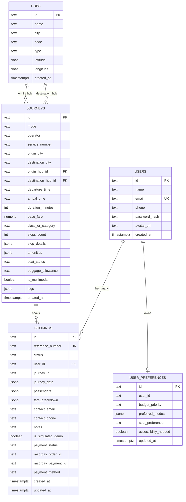

# TripPilot AI — Project Understanding & System Analysis Report

> **Document Type:** System Understanding & Comprehensive Codebase Audit  
> **Target System:** TripPilot AI (Multimodal Travel Platform Prototype)  
> **Auditors / Roles:** Senior Software Architect, Full-Stack Engineer, QA Engineer, Application Security Specialist  
> **Date:** October 23, 2026  
> **Status:** Current State Baseline Established — Preserving All User Changes  

---

## 1. Product Purpose & Implemented Features

### 1.1 Product Vision & Core Purpose
**TripPilot AI** is an intelligent multimodal travel booking website prototype designed for the Indian transit ecosystem. It bridges the gap between conventional multi-tab travel searching and conversational trip planning by providing a single unified platform where users can discover, compare, filter, chain together, and simulate bookings across **six distinct transportation modes**:
1. **Flights** (IndiGo, Air India, Vistara, Akasa Air, SpiceJet)
2. **Trains** (Indian Railways: Vande Bharat Express, Shatabdi Express, Rajdhani, Mail/Express)
3. **Metro Transit** (Namma Metro Purple Line, Chennai Metro Blue Line, Delhi Metro)
4. **Buses** (KSRTC Airavat Club Class, IntrCity SmartBus, Zingbus, VRL Travels, SETC)
5. **Cabs** (UberGo, Ola Prime Sedan, BluSmart EV, UberXL Innova)
6. **Autos** (Namma Yatri Auto, Uber Auto, Electric Treo Rickshaws)

### 1.2 Implemented Feature Matrix

| Feature Area | Implementation Status | Implementation Details & Architecture |
| :--- | :---: | :--- |
| **Unified 6-Mode Search** | ✅ Fully Functional | Search across 7 major transit hubs (Bengaluru, Chennai, Mumbai, Delhi, Hyderabad, Pune, Goa) with city normalization and synonym handling. |
| **Transportation Filters** | ✅ Fully Functional | Mode-specific filters (airlines, direct-only, cabin class, train classes [CC, EC, 2S, 3A, SL], bus AC/sleepers, budget sliders, time windows). |
| **Multimodal Trip Planner (`/planner`)** | ✅ Fully Functional | Signature interactive itinerary composer. Supports adding, removing, swapping, and reordering legs with automated transfer buffer calculation and conflict advisories. |
| **State-Synchronized AI Assistant (`Ctrl+K`)** | ✅ Fully Functional | Dual-mode AI: Groq Cloud LLM (`llama-3.3-70b-versatile`) with high-precision deterministic regex/rule fallback. Directly updates search store and executes UI actions. |
| **Interactive Journey Comparison** | ✅ Fully Functional | 3-way floating compare drawer (`CompareDrawer.tsx`) contrasting fares, durations, transfer counts, and comfort ratings side-by-side. |
| **User Authentication & Session Management** | ✅ Fully Functional | Stateless JWT (HS256) auth with PBKDF2-HMAC-SHA256 password hashing (100k rounds), IP rate-limiting, and registration/login modal. |
| **Demo Booking Lifecycle** | ✅ Fully Functional | Passenger detail collection, server-side tamper-proof fare resolution, cryptographically generated references (`TP-XXXXXXXX`), and boarding pass voucher generation. |
| **Payment Gateway Integration** | ✅ Fully Functional | Dual-mode checkout: Razorpay Test Mode (order creation in paise + HMAC-SHA256 signature verification) and in-app Simulated Payment Bypass. |
| **Booking Management Dashboard (`/bookings`)** | ✅ Fully Functional | User-scoped bookings view, status badges (`CONFIRMED`, `CANCELLED`, `COMPLETED`), filter tabs, and interactive cancellation modal. |

---

## 2. Actual Technology Stack & Framework Versions

The project is structured as a decoupled monorepo with an independent React SPA frontend and a FastAPI Python backend.

### 2.1 Frontend Dependencies (`frontend/package.json`)
- **Core Runtime & UI Framework:** React `19.2.8` & React DOM `19.2.8`
- **Routing Engine:** React Router DOM `7.18.4` (Data/Component router)
- **Bundler & Build Tool:** Vite `8.3.0` with `@vitejs/plugin-react` `6.1.1`
- **Styling Architecture:** Tailwind CSS v4 (`4.3.3`) via `@tailwindcss/vite`, `clsx` `2.1.1`, and `tailwind-merge` `3.7.0`
- **Component Design System:** Bespoke Luxury Ivory design tokens with glassmorphic backdrop filters
- **State Management:** Zustand `5.0.15`
- **Iconography:** Lucide React `1.55.0`
- **Animation & Transitions:** Framer Motion `14.1.0`
- **Type Safety & Linting:** TypeScript `~6.0.2`, Oxlint `1.81.0`
- **Automated Testing:** Vitest `3.2.7`

### 2.2 Backend Dependencies (`backend/requirements.txt`)
- **API Framework:** FastAPI `>=0.110.0`
- **ASGI Server:** Uvicorn `>=0.28.0` with standard event loop
- **Data Validation & Settings:** Pydantic `>=2.6.0`, Pydantic Settings `>=2.2.0`
- **Database Client:** Supabase Python Client `>=2.3.0`
- **AI / LLM Integration:** Groq Python SDK `>=0.30.0` (invoking `llama-3.3-70b-versatile`)
- **Payment Processing:** Razorpay Python Client `>=1.4.1`
- **HTTP Client & Utilities:** HTTPX `>=0.27.0`, python-dotenv `>=1.0.0`
- **Python Runtime:** Python `3.12.3` (Local environment), Python `3.11.9` (`render.yaml` specification)

---

## 3. Complete Application Architecture & Data Flow

```
┌────────────────────────────────────────────────────────────────────────┐
│                        User Browser (Port 5175)                        │
│  ┌───────────────────────┐  ┌────────────────────────────────────────┐ │
│  │   React 19 Frontend   │  │           Zustand State Store          │ │
│  │  - HomePage           │  │  - useSearchStore    - useAuthStore    │ │
│  │  - SearchResultsPage  │  │  - usePlannerStore   - useBookingStore │ │
│  │  - TripPlannerPage    │  │  - useAiStore        - useComparison   │ │
│  │  - BookingReviewPage  │  └───────────────────▲────────────────────┘ │
│  │  - MyBookingsPage     │                      │                      │
│  └──────────┬────────────┘                      │                      │
│             │ Vite Proxy (/api)                 │ UI Action Dispatch   │
└─────────────┼───────────────────────────────────┼──────────────────────┘
              │                                   │
              ▼                                   ▼
┌────────────────────────────────────────────────────────────────────────┐
│                      FastAPI Backend (Port 8001)                       │
│  ┌──────────────────────────────────────────────────────────────────┐  │
│  │ Middlewares: Security Headers, CORS Policy, Validation Handler   │  │
│  └──────────────────────────────────┬───────────────────────────────┘  │
│                                     │                                  │
│  ┌──────────────────────────────────▼───────────────────────────────┐  │
│  │ API Routers:                                                     │  │
│  │  - /api/auth       (Register, Login, Me)                         │  │
│  │  - /api/journeys   (Search, Get by ID)                           │  │
│  │  - /api/multimodal (Plan, Compose Legs, Buffer Validation)       │  │
│  │  - /api/bookings   (Create, Get, Cancel, Update)                 │  │
│  │  - /api/payments   (Config, Create Order, Verify & Book)         │  │
│  │  - /api/ai         (Chat with Groq, Quick Prompts)               │  │
│  │  - /api/metadata   (Transit Hubs, Cities)                        │  │
│  └──────────────────────────────────┬───────────────────────────────┘  │
│                                     │                                  │
│  ┌──────────────────────────────────▼───────────────────────────────┐  │
│  │ Core Services:                                                   │  │
│  │  - JourneyService    - MultimodalService    - AIService          │  │
│  │  - AuthService       - BookingService       - PaymentService     │  │
│  └──────────────────────────────────┬───────────────────────────────┘  │
│                                     │                                  │
│  ┌──────────────────────────────────▼───────────────────────────────┐  │
│  │ Persistence Adapter: DatabaseRepository                          │  │
│  │  (Dual-Mode: Supabase PostgREST <---> In-Memory Seeded Store)    │  │
│  └──────────────────────────────────┬───────────────────────────────┘  │
└─────────────────────────────────────┼──────────────────────────────────┘
                                      │
            ┌─────────────────────────┴─────────────────────────┐
            ▼                                                   ▼
┌───────────────────────┐                           ┌────────────────────┐
│ Supabase Cloud (Postgres)                         │ External Services  │
│  - hubs      - users  │                           │  - Groq Cloud AI   │
│  - journeys  - bookings                            │  - Razorpay Test   │
└───────────────────────┘                           └────────────────────┘
```

### 3.1 Request & Data Flow Traces

#### User Journey 1: Unified Search & Filter Application
1. **User interaction:** User selects "Bengaluru" to "Chennai", chooses date, and toggles "Flight" + "Train".
2. **Frontend State:** `useSearchStore.setOrigin()`, `useSearchStore.setDestination()`, `useSearchStore.toggleMode()` dispatch state updates and call `executeSearch()`.
3. **HTTP Dispatch:** `apiClient.searchJourneys()` constructs query `GET /api/journeys/search?origin=Bengaluru&destination=Chennai&modes=flight&modes=train`.
4. **Backend Pipeline:** `journeys.py` router validates query parameters against `SearchFilters` model.
5. **Business Logic:** `JourneyService.search_journeys()` normalizes city names via `CITY_SYNONYMS` table, queries `DatabaseRepository.get_all_journeys()`, applies hard constraints, filters mode-specific attributes (direct flights, train classes), and sorts by `recommended_score`.
6. **Response & UI Render:** JSON array of `Journey` objects returned to frontend; Zustand stores it in `results`; `JourneyCard.tsx` items animate into view.

#### User Journey 2: AI-Powered Natural Language Journey Planning
1. **User interaction:** User presses `Ctrl+K` and types: *"Find the cheapest flight from Bengaluru to Chennai under ₹3,500"*.
2. **Frontend State:** `useAiStore.sendMessage()` appends the user bubble and calls `apiClient.chatWithAI()`.
3. **Backend Pipeline:** Router `POST /api/ai/chat` applies IP rate limiter (25 req/min) and calls `AIService.process_user_prompt()`.
4. **AI Reasoning:** 
   - Groq Cloud AI runs `llama-3.3-70b-versatile` with system prompt enforcing JSON schema.
   - If Groq is unavailable, `_deterministic_parse()` regex detects city keywords, budget constraints, and mode requests.
5. **Action Proposal:** Assistant generates proposal `action: "search_journeys"`, `parameters: { origin: "Bengaluru", destination: "Chennai", modes: ["flight"], filters: { max_budget: 3500 }, sort_by: "cheapest" }`.
6. **State Synchronization:** In `useAiStore.executeAction()`, proposal is executed against `useSearchStore`, updating inputs, setting filters, and fetching matching results on screen in real time.

#### User Journey 3: Multimodal Trip Customization & Buffer Validation
1. **User interaction:** User visits `/planner`, chooses the "High-Speed Rail Corridor" preset (Cab $\rightarrow$ Vande Bharat $\rightarrow$ Cab).
2. **Modification:** User edits the transfer buffer or swaps the final cab to Metro.
3. **Buffer Validation:** `MultimodalService.validate_connection()` calculates the departure and arrival delta between consecutive legs. If buffer < 15 mins for cab or < 30 mins for train, warnings are attached.
4. **Composition:** `POST /api/multimodal/plan` accepts validated `List[JourneyLeg]`, calculates cumulative fares and durations, caches the composed journey in memory by unique ID, and returns the canonical itinerary.
5. **Handoff:** Clicking "Book Complete Itinerary" sets `activeDraftJourney` in `useBookingStore` and navigates to `/booking/review`.

#### User Journey 4: Secure Booking & Payment Verification Lifecycle
1. **User interaction:** User fills passenger details or clicks "Auto-fill Demo Traveller", then selects "Razorpay Test Card" or "Simulated Bypass".
2. **Auth Gatekeeper:** `BookingReviewPage` checks `useAuthStore.isAuthenticated`. If unauthenticated, `AuthModal` is triggered.
3. **Order Creation:** `POST /api/payments/create-order` creates a Razorpay order in paise (`amount_paise = amount * 100`).
4. **Payment Execution:**
   - In Razorpay test mode, Razorpay Standard Checkout modal opens with test credentials.
   - In simulated mode, an in-app test simulation modal opens.
5. **Tamper-Proof Verification:**
   - Frontend posts to `POST /api/payments/verify-and-book`.
   - Backend ignores any client-supplied prices and strictly resolves the canonical journey from the database via `journey_id`.
   - Backend computes `expected_fare = canonical_journey.total_fare * len(passengers) * 1.12`.
   - Backend verifies HMAC-SHA256 signature using `RAZORPAY_KEY_SECRET`.
   - Booking record created with `payment_status = 'PAID'`, `status = 'CONFIRMED'`, and cryptographically generated `TP-XXXXXXXX` reference.
6. **Confirmation:** User redirected to `/booking/confirmation/:id` displaying the boarding pass voucher.

---

## 4. Frontend Architecture: Pages, Components, Routes & State

### 4.1 Route Map (`frontend/src/app/router.tsx`)
| Route Path | Component | Description & Responsibilities |
| :--- | :--- | :--- |
| `/` | `HomePage` | Hero section, unified search widget, quick prompt chips, popular routes carousel. |
| `/explore` | `SearchResultsPage` | Full search results across modes, responsive sidebar filters, mode pills, 3-way compare drawer. |
| `/planner` | `TripPlannerPage` | Multimodal itinerary builder, leg reordering, custom leg modal, connection buffer analysis. |
| `/booking/review` | `BookingReviewPage` | Demo passenger form, fare breakdown, Razorpay & simulated payment checkout handlers. |
| `/booking/confirmation/:id` | `BookingConfirmationPage` | High-fidelity boarding pass voucher, reference number, travel timeline, printable voucher. |
| `/bookings` | `MyBookingsPage` | Personal booking dashboard, status filters, confirmed ticket passes, cancellation dialog. |

*Architectural Observation:* PRD sections 4 & 9 suggested dedicated `/journey/:id` and `/profile` routes. In the current implementation:
- Journey details expand inline via `JourneyTimeline.tsx` and accordion cards inside `JourneyCard.tsx`.
- User profile & authentication are managed via the persistent `Header` dropdown and global `AuthModal.tsx`.

### 4.2 State Management Architecture (Zustand Stores)
1. **`useSearchStore.ts`**: Holds origin, destination, travel dates, passenger counts, selected transit modes, active search filters, sort criteria, and search execution logic.
2. **`usePlannerStore.ts`**: Manages multimodal draft legs, active composed itinerary, leg swapping/reordering, and connection recalculation.
3. **`useBookingStore.ts`**: Manages active draft journey, user bookings list, booking creation, payment verification, and cancellation calls.
4. **`useAuthStore.ts`**: Manages authenticated user state, JWT session token, modal visibility (`login` vs `register`), and auto-initialization from `localStorage`.
5. **`useAiStore.ts`**: Manages assistant slide-over drawer (`isOpen`), conversational history (`messages`), thinking state, quick prompts, and action execution dispatch.
6. **`useComparisonStore.ts`**: Manages 1–3 selected itineraries for side-by-side comparison in the bottom docked compare drawer.

---

## 5. Backend Architecture: Endpoints, Routers & Middleware

### 5.1 Route & Endpoint Inventory

```
FastAPI Router Topology
├── /api/auth
│   ├── POST /register        (User registration with IP rate limiting)
│   ├── POST /login           (User authentication & JWT generation)
│   └── GET  /me              (Retrieve authenticated profile via Bearer token)
├── /api/metadata
│   └── GET  /cities          (Transit hubs and supported cities)
├── /api/journeys
│   ├── GET  /search          (Multi-criteria search with query constraints)
│   └── GET  /{journey_id}    (Canonical journey lookup from DB & composed cache)
├── /api/multimodal
│   └── POST /plan            (Validated multimodal leg composition & buffer calculation)
├── /api/bookings
│   ├── GET  ""               (List user-scoped bookings)
│   ├── POST ""               (Create booking with canonical server fare lookup)
│   ├── GET  /{booking_id}    (Retrieve booking with ownership verification)
│   ├── POST /{booking_id}/cancel (Cancel booking with ownership verification)
│   └── PATCH /{booking_id}   (Update contact info/notes with ownership verification)
├── /api/payments
│   ├── GET  /config          (Public Razorpay Key ID and test status)
│   ├── POST /create-order    (Create Razorpay order in paise)
│   └── POST /verify-and-book (HMAC signature verification + booking confirmation)
├── /api/ai
│   ├── POST /chat            (LLM / Deterministic NLP conversational engine)
│   └── GET  /quick-prompts   (Suggested user prompt shortcuts)
└── /api/health
    └── GET  ""               (Healthcheck, service metadata, and Supabase status)
```

### 5.2 Middleware Pipeline
1. **`validation_exception_handler` (`main.py`)**: Intercepts FastAPI `RequestValidationError` and transforms low-level Pydantic traces into clean, human-readable JSON responses (`detail: "field: error message"`).
2. **`add_security_headers` (`main.py`)**: OWASP-recommended HTTP response headers injected into every response:
   - `X-Content-Type-Options: nosniff`
   - `X-Frame-Options: DENY`
   - `X-XSS-Protection: 1; mode=block`
   - `Referrer-Policy: strict-origin-when-cross-origin`
   - `Permissions-Policy: geolocation=(), microphone=(), camera=()`
3. **`CORSMiddleware` (`main.py`)**: Hardened origin configuration:
   - Excludes local development origins in production (`ENVIRONMENT == 'production'`).
   - Uses strict regex restricted to owner deployment slugs: `r"^https://ai[-_]trip[-_]planner(-[a-zA-Z0-9_\-]+)?-hariprathap1804.*\.vercel\.app$"`.
   - Whitelists explicit verbs: `["GET", "POST", "PATCH", "DELETE", "OPTIONS"]`.
   - Exposes `Retry-After` and `X-Content-Type-Options`.

---

## 6. Database Schema, Relationships & Persistence

### 6.1 Database Entity Relationship Diagram (ERD)



### 6.2 Persistence Resilience & Fallback Engine
The application implements an **adaptive dual-mode persistence architecture** (`backend/app/supabase_client.py`):
1. **Primary Mode (Supabase PostgreSQL):** Activated when `SUPABASE_URL` and `SUPABASE_KEY` are provided. Queries are executed via PostgREST SDK with indexed lookups (`idx_bookings_user_id`, `idx_bookings_contact_email`, `idx_users_email`).
2. **Fallback Mode (In-Memory Prototype Repository):** If Supabase credentials are not configured, the backend seamlessly initializes internal in-memory data structures from `backend/app/data/mock_db.py`. All mutations (bookings, registrations, cancellations) persist in memory for the lifecycle of the server process.

---

## 7. Authentication, Authorization & Security Posture

### 7.1 Authentication Architecture
- **Password Protection:** Passwords hashed using PBKDF2 with HMAC-SHA256, 16 bytes of cryptographically random salt, and 100,000 iterations. Stored format: `salt_hex$key_hex`.
- **Token Generation:** Stateless JWT signed with HMAC-SHA256 (`HS256`). Payloads carry `sub` (user ID), `email`, `name`, `iat`, and `exp` (7 days validity).
- **Secret Key Security:** `config.py` enforces that in production, `SECRET_KEY` must be explicitly set or server startup fails. In development, an ephemeral 256-bit random key is generated.
- **Brute-Force & Credential Stuffing Defense:** A sliding-window in-memory rate limiter protects `/api/auth/register` and `/api/auth/login` (maximum 10 attempts per 60 seconds per IP).

### 7.2 Authorization & Object-Level Access Control (IDOR Defense)
- Prior security audits identified critical IDOR vulnerabilities on booking inspection, cancellation, and modification.
- Remediated implementation:
  - `GET /api/bookings` requires authentication; queries strictly match the authenticated user's `user_id` or verified email.
  - Endpoints `GET /api/bookings/{id}`, `POST /api/bookings/{id}/cancel`, and `PATCH /api/bookings/{id}` execute `verify_booking_ownership(booking, current_user)`. If the booking does not belong to the user, an HTTP `403 Forbidden` is raised.

---

## 8. AI Travel Assistant Integration & Natural Language Engine

### 8.1 LLM Architecture & Provider Independence
The AI engine (`backend/app/services/ai_service.py`) is decoupled from specific providers:
- **Primary LLM:** Groq Cloud AI executing `llama-3.3-70b-versatile` with low latency (~300–800ms) and `response_format={"type": "json_object"}`.
- **Deterministic Engine Fallback:** If Groq is not configured, rate-limited, or fails, the service falls back to a deterministic rule-and-regex engine with zero operational downtime.

### 8.2 Tool & Action Proposal System
The AI does not merely generate text; it acts as an agentic copilot outputting structured `action_proposal` objects:
- `search_journeys`: Sets origin, destination, transit modes, budget filters, and sorting.
- `apply_filters`: Updates active filter state without changing origin/destination.
- `plan_multimodal_trip`: Composes custom door-to-door multimodal itineraries.
- `quick_book`: Instantly selects a matching flight/train and launches the booking drawer.
- `get_bookings`: Navigates to user bookings.
- `cancel_demo_booking`: Prompts for confirmation before issuing cancellation.
- `open_login`: Prompts user to log in when querying personal bookings without an active session.

### 8.3 Context Handling & Tenant Isolation
- User queries targeting bookings (`"Show my bookings"`, `"Cancel TP-12345"`) pass the authenticated `user_id` and `user_email` to the AI service. Unauthenticated users are prevented from viewing or modifying bookings.
- Prompts are restricted to a maximum of 1,000 characters with an IP-based rate limiter (25 requests per minute).

---

## 9. Six Transportation Modes & Filter Engines

| Mode | Providers / Carriers | Specific Attributes & Filters | Seeded Volume |
| :--- | :--- | :--- | :---: |
| ✈️ **Flights** | IndiGo, Air India, Vistara, Akasa Air, SpiceJet | Direct-only filter, cabin class (Economy, Premium Economy), baggage allowances (7kg cabin + 15–25kg check-in), amenities (meals, wifi, power). | 50+ routes |
| 🚆 **Trains** | Indian Railways (Vande Bharat, Shatabdi, Rajdhani, Express) | Travel class (1A, 2A, 3A, SL, CC, EC), punctuality scores, meal inclusions, rotating seats. | 50+ services |
| 🚇 **Metro** | Namma Metro (Purple), Chennai Metro (Blue), Delhi Metro | 5-minute headways, station interchanges, AC, luggage racks, smartcard ticketing. | 25+ routes |
| 🚌 **Buses** | KSRTC Airavat, IntrCity, Zingbus, VRL, SETC | Multi-axle AC sleeper, AC seater, non-AC deluxe, live tracking, overnight sleeper routes. | 50+ services |
| 🚕 **Cabs** | UberGo, Ola Prime, BluSmart EV, UberXL | Sedan, Hatchback, SUV, Zero-emission EV, luggage boot capacity, instant ETA dispatch. | 25+ options |
| 🛺 **Autos** | Namma Yatri, Uber Auto, Electric Treo Rickshaws | First/last-mile station connectors, open-air, 3-seater, digital meter, ₹40–140 fares. | 25+ options |

---

## 10. Demo Booking Lifecycle & Persistence

1. **Selection:** User picks a single-mode journey from `/explore` or custom multimodal route from `/planner`.
2. **Passenger Entry:** Validated full name, age (1–120), gender, contact email, and phone. Shortcut: "Auto-fill Demo Traveller".
3. **Price Calculation:** Strict server calculation:
   $$\text{Base Fare} = \text{Unit Fare} \times \text{Passenger Count}$$
   $$\text{Taxes \& Fees} = \text{Base Fare} \times 0.12$$
   $$\text{Total Amount} = \text{Base Fare} + \text{Taxes \& Fees}$$
4. **Checkout:** Choice between Razorpay Test Card sandbox and instant Simulated Demo Bypass.
5. **Confirmation:** Persistent ticket issued with unique reference `TP-XXXXXXXX` and boarding pass visualizer.
6. **Cancellation & Editing:** User can edit passenger contact information or cancel the booking; status updates in Supabase or memory store.

---

## 11. Environment Configuration & External Services

### 11.1 Backend Configuration (`backend/.env`)
| Variable | Required in Prod | Description | Safe Example / Default |
| :--- | :---: | :--- | :--- |
| `PORT` | Optional | Backend listening port | `8001` (Dev), `${PORT}` (Prod) |
| `ENVIRONMENT` | Recommended | Application runtime mode | `development` or `production` |
| `SECRET_KEY` | **Required in Prod** | Cryptographic key for JWT token signatures | 256-bit hex string |
| `TOKEN_EXPIRE_DAYS` | Optional | JWT session token validity window | `7` |
| `GROQ_API_KEY` | Optional | API Key for Groq Cloud LLM | `gsk_...` (Falls back to deterministic) |
| `GROQ_MODEL` | Optional | Model identifier | `llama-3.3-70b-versatile` |
| `SUPABASE_URL` | Optional | Supabase PostgreSQL Project URL | `https://xxxx.supabase.co` |
| `SUPABASE_KEY` | Optional | Supabase anon or service role key | `eyJ...` (Falls back to in-memory) |
| `RAZORPAY_KEY_ID` | Optional | Razorpay Test Key ID | `rzp_test_...` |
| `RAZORPAY_KEY_SECRET`| Optional | Razorpay Test Key Secret | Secret string |
| `FRONTEND_URL` | Recommended | Production frontend domain for CORS | `https://trippilot.vercel.app` |
| `ADDITIONAL_CORS_ORIGINS`| Optional| Comma-separated additional allowed domains | `https://custom-domain.com` |

### 11.2 Frontend Configuration (`frontend/.env`)
| Variable | Description | Safe Example / Default |
| :--- | :--- | :--- |
| `VITE_API_URL` | Public backend URL for cross-origin deployments | Empty in Dev (Vite proxy `/api`), `https://backend.railway.app` in Prod |

---

## 12. Existing Tests, Test Coverage & Incomplete Features

### 12.1 Automated Test Suites
- **Frontend Test Suite:** 3 test files in `frontend/src/tests/` running on Vitest (`3.2.7`):
  - `bookingLifecycle.test.ts` (3 tests passed)
  - `journeyService.test.ts` (4 tests passed)
  - `multimodalService.test.ts` (3 tests passed)
- **QA Test Limitation Assessment:**
  The current 10 Vitest tests are **shallow unit tests** testing isolated mock calculations rather than rendering React components or testing live Zustand stores and API clients.
- **Backend Test Suite:** **ZERO automated tests**. No `test_*.py` files exist in `backend/`. Pytest collected 0 items.

### 12.2 Known Incomplete Features & Roadmap Items
1. **Frontend Date Boundaries:** `UnifiedSearchWidget.tsx` currently allows users to select historical dates centuries in the past. Needs HTML `min` attribute set to today's date (`VAL-09`).
2. **Search Input Number Clamping:** `min_budget` and `max_budget` in `FilterSidebar.tsx` allow free text without client-side inverted range warnings (`VAL-05`).
3. **No Standalone Journey Details Page:** PRD referenced `/journey/:id`, currently handled exclusively through accordion cards.
4. **Backend Automated Test Suite Missing:** Need comprehensive Pytest suite for authentication, journey filtering, multimodal buffer validation, and tamper-proof payment verification.

---

## 13. Security Posture: Resolved Protections & Open Findings

### 13.1 Verified Security Protections (Already Remediated)
- ✅ **IDOR Protection:** Booking endpoints enforce `get_current_user_required` and verify `booking.user_id == current_user.id`.
- ✅ **Tamper-Proof Fares:** Server ignores client-supplied fares and recalculates totals strictly from database records.
- ✅ **PostgREST Injection Defense:** Route parameters strictly validated using alphanumeric regex `^[a-zA-Z0-9_\-]{3,64}$`.
- ✅ **Brute-Force Protection:** Auth endpoints protected with sliding-window IP rate limiting (10 req/min).
- ✅ **OWASP Headers:** Strict security headers applied across all HTTP responses.
- ✅ **CORS Hardening:** Removed wildcard domains and restricted CORS regex to the project owner's account slug (`hariprathap1804`).
- ✅ **Input Validation:** Strict Pydantic models for passenger names, ages (1–120), emails, and phone digits.

### 13.2 Open Security Findings & Recommendations
1. **Supabase RLS Policies in `schema.sql`:** The database schema currently allows public SELECT and INSERT on `bookings` and `users`. While the FastAPI layer enforces strict authentication, the Supabase PostgreSQL layer should have RLS tightened so public anonymous keys cannot read arbitrary rows directly via PostgREST.
2. **Browser Storage of JWTs:** JWT tokens are persisted in `localStorage` (`trippilot_auth_token`), which is accessible to JavaScript and vulnerable if an XSS attack occurs. A future migration to HttpOnly cookies is recommended for production.
3. **Predictable 6-digit references in Seed Data:** Seeded bookings use 6-digit references like `TP-849201`, whereas the newly implemented generator creates cryptographically secure 8-character references (`TP-XXXXXXXX`).

---

## 14. Installation, Local Execution & Build Instructions

### 14.1 Prerequisites
- **Node.js:** v18.x or v23.x
- **Python:** 3.10, 3.11, or 3.12
- **Package Managers:** `npm` (v10+) and `pip`

### 14.2 Running the Backend (FastAPI)
```bash
# From workspace root
cd backend

# Create and activate virtual environment (optional but recommended)
python -m venv venv
venv\Scripts\activate      # Windows PowerShell / CMD
# source venv/bin/activate  # macOS / Linux

# Install dependencies
pip install -r requirements.txt

# Start FastAPI development server on port 8001
python -m uvicorn app.main:app --host 127.0.0.1 --port 8001 --reload
```
- Health Check: `http://127.0.0.1:8001/api/health`
- OpenAPI Swagger Docs: `http://127.0.0.1:8001/docs`

### 14.3 Running the Frontend (Vite + React)
```bash
# From workspace root
cd frontend

# Install npm dependencies
npm install

# Start Vite dev server on port 5175
npm run dev
```
- Local Application: `http://localhost:5175`

### 14.4 Running Automated Tests
```bash
# Frontend Unit & Integration Tests
cd frontend
npm run test

# Frontend TypeScript Typecheck & Production Build
npm run build
```

---

## 15. Missing Configuration & External Dependencies Summary

| Service | Impact if Missing | Built-in Fallback Behavior |
| :--- | :--- | :--- |
| **Groq Cloud API Key** | High | Automatically falls back to deterministic rule/regex NLP engine. Core assistant features remain functional. |
| **Supabase Credentials** | Medium | Automatically falls back to in-memory seeded prototype database. Search, booking, and auth continue working. |
| **Razorpay Test Keys** | Low | Automatically presents in-app test simulation modal. Bookings can be confirmed without real API credentials. |
| **SECRET_KEY** | Critical in Prod | In development, generates an ephemeral 256-bit cryptographic key. In production, raises fatal startup error. |

---

> [!NOTE]
> **Summary & Baseline Status:** The TripPilot AI repository has been fully inspected across every layer. All existing uncommitted changes in the working directory have been preserved intact. No breaking changes or destructive modifications were made.
